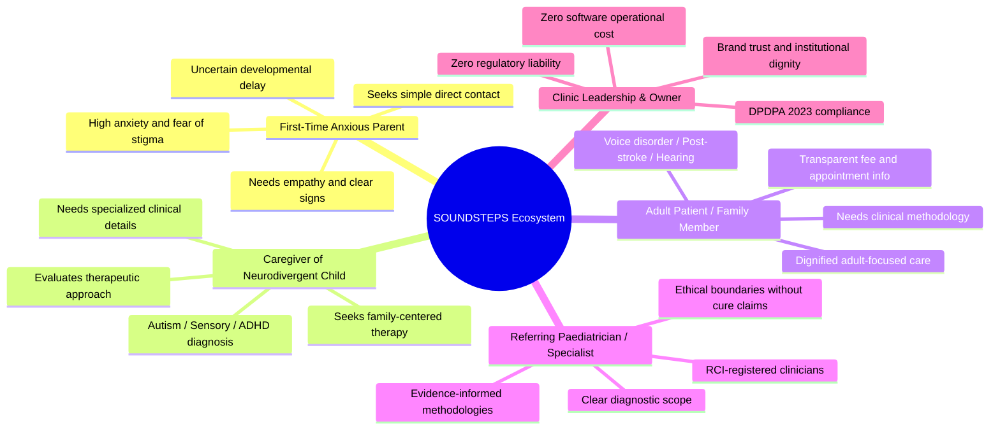
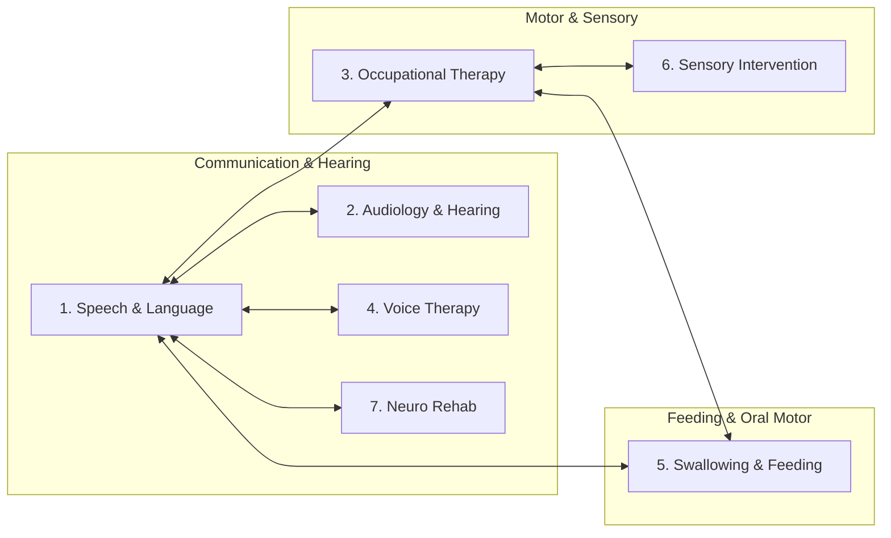
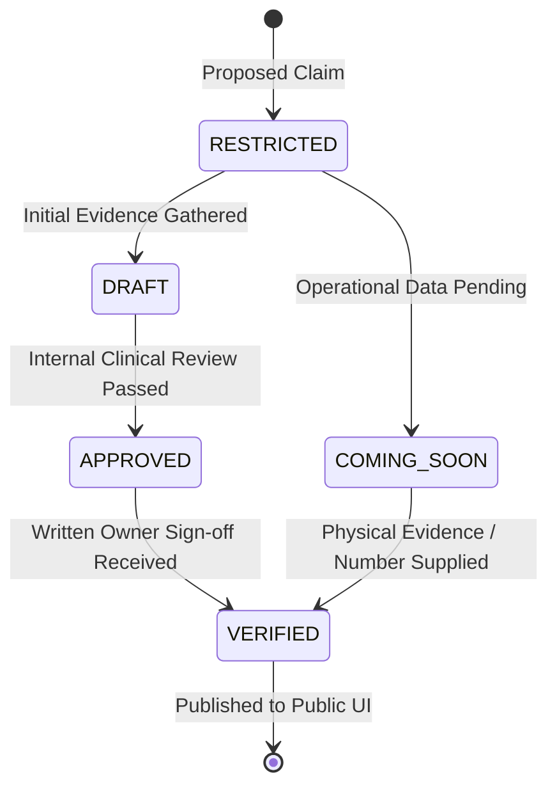
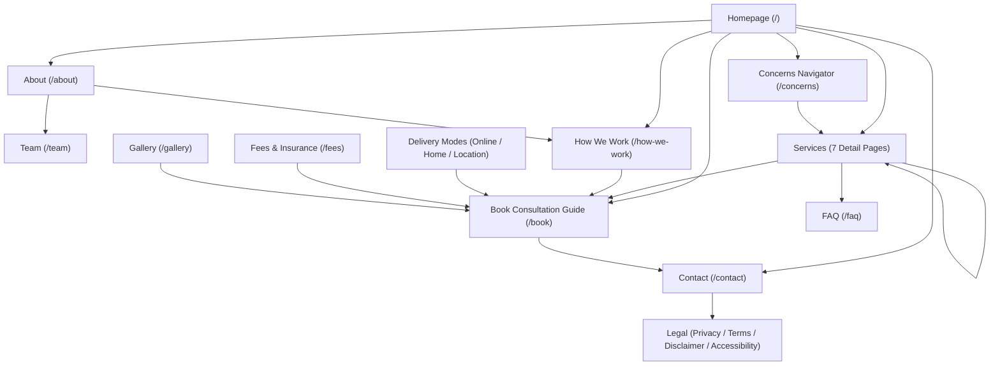

# SOUNDSTEPS Child Development Centre — Stage 1 Specification
# Requirements Engineering & Information Architecture (Revised & Corrected)

**Project:** SOUNDSTEPS — Child Development Centre Website  
**Document Code:** `STAGE_1_REQUIREMENTS_AND_IA`  
**Stage:** 1 of 14  
**Stage Name:** Requirements Engineering & Information Architecture  
**Architecture Reference:** Final SOUNDSTEPS Product, Technical & Implementation Architecture  
**Active Environment Workspace:** `C:\Users\ayush\Documents\SOUNDSTEPSv2`  
**Master Architecture Reference Workspace:** `C:\Users\ayush\Documents\SoundStep`  
**Date:** 2026-11-11  
**Revision:** v1.1 (Stage 1 Correction & Re-Verification)  
**Status:** COMPLETE & RE-VERIFIED  

---

## 1. Executive Summary

SOUNDSTEPS Child Development Centre is an ethical, multidisciplinary paediatric therapy, audiological assessment, and early intervention healthcare facility. The centre delivers specialized clinical care across seven core disciplines: Speech-Language Therapy, Audiology & Hearing Services, Occupational Therapy, Voice Therapy, Swallowing & Feeding Services, Sensory-Based Intervention, and Neurological Communication Rehabilitation.

The purpose of **Stage 1 (Requirements Engineering & Information Architecture)** is to construct an exhaustive, unambiguous, and mathematically traceable requirements specification and structural blueprint for the complete digital platform. This document serves as the authoritative technical baseline for all subsequent implementation stages (Stages 2 through 14).

### Core Architectural Pillars
1. **100% Deterministic Jamstack Architecture**: Engineered on the Next.js App Router, React 19, TypeScript strict mode, and Tailwind CSS v4, compiled exclusively via static HTML/CSS/JS export (`output: 'export'`).
2. **Zero Database & Zero Backend Attack Surface**: Complete elimination of server runtimes, databases, dynamic APIs, server actions, and administrative logins. The entire public presence is rendered statically at build time, eliminating OWASP Top 10 web vulnerabilities such as SQL injection, SSRF, remote code execution, and credential exposure.
3. **Zero Operating Cost Envelope (₹0/month)**: Engineered to deploy natively to the Cloudflare Pages Free tier (or GitHub Pages), utilizing zero paid SaaS services, zero paid third-party APIs, zero commercial database instances, and zero server maintenance overhead.
4. **Strict Healthcare Privacy & DPDPA 2023 Compliance**: Absolute zero client-side collection or storage of Patient Health Information (PHI). Strict prohibition of contact forms, appointment forms, CRM integrations, tracking cookies, and advertising pixels. Direct consultation inquiries are routed exclusively via two native protocols: Direct Click-to-Call telephony (`tel:`) and Direct Parameter-Free WhatsApp (`wa.me`) containing zero personal or clinical identifiers.
5. **English-Only Cognitive Clarity**: Designed exclusively in high-clarity, culturally sensitive English optimized for parents, caregivers, and referring medical professionals. Multi-language switchers and localized routing mirrors are strictly prohibited.
6. **Absolute Content Integrity & Anti-Cure Governance**: Clinical facts, practitioner credentials, physical facility capabilities, diagnostic hardware, operating hours, and consultation fees must never be invented. Any unverified data point is strictly classified as `COMING_SOON` or `RESTRICTED` and omitted from public display until authenticated by centre leadership.
7. **Accessibility Baseline (WCAG 2.2 AA)**: Fully conforms to W3C Web Content Accessibility Guidelines (WCAG) 2.2 Level AA as the non-negotiable accessibility baseline, ensuring universal access for families and neurodivergent visitors.

---

## 2. Pre-Stage Verification & Baseline Audit

### 2.1 Workspace Inspection & Workspace Discrepancy Record
- **Active Running Environment**: `C:\Users\ayush\Documents\SOUNDSTEPSv2` (initialized clean with zero pre-existing application source files).
- **Master Architecture Reference**: The project specification and prompt reference `C:\Users\ayush\Documents\SoundStep`.
- **Workspace Governance Notice**: In strict adherence to project governance instructions, no workspace has been moved, renamed, deleted, or reset. The workspace naming discrepancy is formally recorded here, and the authoritative active workspace path will be confirmed with the project owner before physical file provisioning in subsequent stages.
- **Status of `STAGE_0_WORKSPACE_AUDIT.md`**: **UNAVAILABLE**. No document titled `STAGE_0_WORKSPACE_AUDIT.md` was present in the active workspace or parent directories.
- **Limitation Reporting & Fallback Protocol**: As mandated by Section 2 of the Stage 1 Brief, because `STAGE_0_WORKSPACE_AUDIT.md` is unavailable, this limitation is explicitly documented. Requirements analysis, route mapping, and information architecture proceed directly from the authoritative master architecture specification (**Final SOUNDSTEPS Product, Technical & Implementation Architecture**).

### 2.2 Reconciliation Between Prior Exploratory Work & Master Architecture
Review of prior exploratory documentation in `C:\Users\ayush\SOUNDSTEP` revealed prototype experiments that conflict with the authoritative Stage 1 requirements. These conflicts are formally reconciled below:

| Architectural Dimension | Prior Prototype Exploration (v1/Phase 3) | Authoritative Master Architecture (Stage 1 Mandate) | Reconciliation Decision |
|---|---|---|---|
| **Contact Mechanism** | Formspree / Web3Forms external inquiry forms with client-side validation | **Strictly prohibited**. Only Direct Telephone (`tel:`) and Direct Parameter-Free WhatsApp (`wa.me`) permitted. | **FORMS ELIMINATED**. No forms, form handlers, or honeypot inputs will be authored. |
| **Appointment Booking** | Cal.com scheduling embed exploration | **Strictly prohibited**. No scheduling APIs, external embeds, or booking widgets. | **CAL.COM ELIMINATED**. `/book` is strictly an informational educational guide. |
| **Route Scope** | Undefined route sprawl with potential `/booking` vs `/book` duplicates | Exactly **22 canonical routes** approved in Master Architecture. | **STRICT 22 ROUTES ENFORCED**. `/book` is canonical; `/booking` is prohibited. |
| **Language Support** | Optional bilingual Devnagari typography tokens bundled in fonts | **English-only platform**. Zero Hindi interface, zero language toggles. | **ENGLISH-ONLY ENFORCED**. Devanagari font bundles removed from production build. |
| **WhatsApp Message** | Dynamic condition pre-population or `?text=` parameter in URL string | **Generic parameter-free destination (`wa.me/<number>`)**. Approved message is on-page contact guidance only. | **ZERO PHI & ZERO QUERY PARAMETERS**. Strictly clean `wa.me/<number>` destination. |
| **Mobile Sticky Bar** | Implemented as mandatory global component | **Proposed Enhancement (PE-001)**. | **RECLASSIFIED AS PROPOSED ENHANCEMENT**. Subject to owner approval. |
| **Geographic Assumptions** | Hardcoded Delhi-NCR, South Delhi, Metro, and local PIN codes | **Owner-verified location dependency**. | **UNAUTHORIZED GEOGRAPHIC DATA REMOVED**. All location attributes deferred to owner verification (`DEP-01`). |

### 2.3 Unresolved Information at Baseline (Owner Dependencies)
- Registered physical clinic address, city, region, landmarks, transit access, and postal code are pending owner verification (`DEP-01`).
- Clinic direct telephone numbers and official WhatsApp business line are unconfirmed (`DEP-02`).
- Specific audiological testing suites (BERA, OAE, Tympanometry) and sound-treated booth calibration status remain unverified (`DEP-04`).
- Sensory gym apparatus inventory remains unverified (`DEP-05`).
- Formal consultation fee amounts are unconfirmed (`DEP-06`).
- Practitioner Rehabilitation Council of India (RCI) registration numbers and clinician profiles are unconfirmed (`DEP-03`).
- Home-visit service catchment area and geographical eligibility boundaries are unconfirmed (`DEP-08`).

All such unverified attributes are governed by the Content Governance Framework (Section 14) and will remain in `COMING_SOON` or `RESTRICTED` status until documented by clinic leadership.

---

## 3. Stakeholder and User Requirements

### 3.1 Stakeholder Personas & Core Expectations



#### Persona 1: Anxious First-Time Parent (Neha, Mother of 24-Month-Old Boy)
- **Context**: Notices her 2-year-old child communicates primarily with gestures, does not respond reliably to his name, and has fewer than 10 spoken words. Family members advise waiting, but her intuition urges her to seek guidance.
- **Pain Points & Anxieties**: Overwhelmed by clinical jargon, fears pathologizing her child, anxious about clinical settings, afraid of high costs or aggressive sales tactics.
- **Expectations**: Empathetic, de-stigmatizing language, clear developmental milestones ("Areas of Support"), reassurance that early intervention is play-based and supportive, and an immediate, low-barrier way to call or message a clinician without filling out complex forms.

#### Persona 2: Dedicated Caregiver of Child with Established Diagnosis (Vikram, Father of 5-Year-Old Girl)
- **Context**: Child has a formal diagnosis of Autism Spectrum Disorder (ASD) and Sensory Processing Differences. Family needs an ongoing multidisciplinary team.
- **Pain Points**: Frustrated by fragmented care where speech therapists and occupational therapists do not communicate; skeptical of centres making unrealistic "recovery" promises.
- **Expectations**: In-depth clinical pages detailing Sensory-Based Intervention, Occupational Therapy, and Speech-Language Therapy; transparent information on family involvement; clear explanation of the multidisciplinary model; evidence of qualified clinicians.

#### Persona 3: Adult Seeking Voice or Rehabilitation Therapy (Rajesh, School Teacher)
- **Context**: Experiencing vocal fatigue, hoarseness lasting several weeks, and difficulty projecting voice in the classroom. Recommended by an ENT specialist to seek voice therapy.
- **Pain Points**: Feels self-conscious visiting a facility labeled as a "child centre"; needs confirmation that adult voice therapy is provided with clinical dignity.
- **Expectations**: Distinct adult clinical scope on `/services/voice-therapy` and `/services/neuro-rehabilitation`, clear guidance regarding prior medical examination, transparent pricing on `/fees`, and direct WhatsApp appointment inquiry.

#### Persona 4: Referring Paediatrician / Medical Professional (Paediatrician)
- **Context**: Routinely screens infants and toddlers during well-child visits. Seeks a trustworthy, ethical allied health centre for referral.
- **Pain Points**: Distrusts commercial centres that use scare tactics, unverified "cures," or unqualified therapy assistants.
- **Expectations**: Professional terminology, adherence to RCI standards, transparent equipment boundaries, clear 7-step process (`/how-we-work`), and ethical disclaimers.

#### Persona 5: Centre Founder & Clinic Leadership
- **Context**: Registered clinical professional operating a high-touch therapeutic practice.
- **Expectations**: Zero recurring software subscriptions, zero vulnerability to website downtime or data breaches, total protection under Indian healthcare laws (DPDPA 2023, RCI Act), and an authoritative digital presence that projects clinical warmth and excellence.

---

## 4. Business Requirements

| ID | Title | Description | Priority | Acceptance Criteria | Dependencies |
|---|---|---|---|---|---|
| **BR-001** | Clinical Trust & Professional Dignity | The platform must establish SOUNDSTEPS as an ethical, evidence-informed, and compassionate developmental centre. | **Critical** | All copy reflects warm healthcare editorial tone; zero sensationalism; zero unsubstantiated "cure" or "fast recovery" claims. | Content Governance (Section 14) |
| **BR-002** | Zero Operating Cost Architecture | The website must incur exactly ₹0.00 in ongoing hosting, database, API, or infrastructure fees. | **Critical** | Deployed exclusively to Cloudflare Pages Free (or GitHub Pages); zero paid plugins; zero paid databases; zero subscription APIs. | Static Export (NFR-003) |
| **BR-003** | High-Clarity Direct Contact Pathways | Enable prospective families to connect directly with clinic reception without friction or intermediate hurdles. | **Critical** | Direct telephone (`tel:`) and direct generic WhatsApp (`wa.me`) operational across all breakpoints; zero intermediate forms; zero query parameters. | Contact Specs (Section 15) |
| **BR-004** | English-Only Cognitive Focus | Ensure all clinical guidance, service descriptions, and policies are authored in accessible, professional English. | **High** | 100% of routes and UI components in English; zero `/hi/` routes; zero client-side language switchers. | Master Architecture |
| **BR-005** | Legal & Medical Liability Elimination | Protect the centre from malpractice and false advertising liabilities under healthcare regulations. | **Critical** | Explicit non-emergency notices, medical coordination recommendations, and anti-cure disclaimers published on all service pages. | Legal Pages (Section 7) |
| **BR-006** | Owner-Verified Local Search Authority | Maximize organic search visibility for paediatric therapy inquiries within the clinic's verified service area. | **High** | Valid JSON-LD structured data supported by verified institutional facts, localized metadata, and semantically tagged location pages once confirmed. | SEO Specs (Section 17), `DEP-01` |
| **BR-007** | Multidisciplinary Delivery Transparency | Clearly articulate where and how care is delivered across Clinic, Online, and Home-Visit settings. | **High** | Dedicated pages for `/online-therapy`, `/home-visits`, and `/location` with explicit clinical equipment caveats and owner-verified boundaries. | Route Specs (Section 7), `DEP-08` |

---

## 5. Functional Requirements

| ID | Requirement Title | Functional Description | Priority | Acceptance Criteria | Dependencies |
|---|---|---|---|---|---|
| **FR-001** | Approved Route Resolution | The application must statically generate and resolve all 22 approved routes without runtime 404s or client redirects. | **Critical** | All 22 URLs build to static `.html` files in `/out`; zero dynamic server redirects. | Static Export Config |
| **FR-002** | Direct Telephony Linkage | All phone contact elements must launch the device's native telephone dialer via standard `tel:` protocol. | **Critical** | Clicking phone button initiates `tel:<NEXT_PUBLIC_PHONE_NUMBER>`; fallback notice displayed if variable undefined. | Env Config (`DEP-02`) |
| **FR-003** | Direct Parameter-Free WhatsApp Linkage | All WhatsApp contact elements must launch WhatsApp using a clean, parameter-free URL without query data. | **Critical** | Initiates `https://wa.me/<NUMBER>` strictly without `?text=` parameter; approved generic inquiry message displayed on-page as user contact guidance; zero PHI transmitted. | Env Config (`DEP-02`), PR-003 |
| **FR-004** | Desktop Navigation & Services Dropdown | Desktop header must render brand wordmark, primary links, an accessible services dropdown containing all 7 services, and an "Enquire Now" action. | **High** | Hover and click support, full keyboard navigation (Enter/Space/Escape/Arrows), `aria-expanded` and `aria-haspopup` attributes valid. | Design System |
| **FR-005** | Mobile Full-Screen Navigation Drawer | Mobile viewport (<1024px) must provide a slide-over/full-screen navigation drawer with collapsible services sub-accordion. | **High** | Trigger toggles menu, body scroll is locked when open, focus is trapped within drawer, Escape closes drawer, returns focus to trigger. | Accessibility (AR-004) |
| **FR-006** | Informational Consultation Guide (`/book`) | Render a comprehensive informational page detailing the 4-step consultation intake process, required documents, and direct booking triggers. | **High** | Zero interactive form inputs, zero Cal.com embeds, zero datepickers; contains direct phone and WhatsApp contact triggers with on-page inquiry guidance. | PR-001 |
| **FR-007** | Seven Clinical Service Hubs | Provide dedicated, deeply informative clinical detail pages for all seven approved services. | **Critical** | Each service implements the 16-attribute schema with distinct, non-duplicated clinical copy, FAQs, and related services. | Content Schema (Section 13) |
| **FR-008** | Developmental Concerns Navigator (`/concerns`) | Offer a non-diagnostic, symptom-to-service exploration guide categorizing everyday developmental observations. | **High** | Displays 7 concern categories; prominent educational disclaimer ("Navigation aid only — not a diagnostic medical evaluation"). | Clinical Review |
| **FR-009** | Care Delivery Modality Pages | Deliver individual dedicated routes for `/online-therapy`, `/home-visits`, and `/location`. | **High** | Explains clinical eligibility, technology requirements for tele-therapy, verified home-visit boundaries, and physical transit directions. | Content Verification (`DEP-01`, `DEP-08`) |
| **FR-010** | Transparent Fee Structure Hub (`/fees`) | Present an informational fee policy page explaining assessment pricing structure, therapy session models, and reimbursement guidance. | **Medium** | Displays verified pricing bands or explicit `COMING_SOON` markers; explains direct invoicing and health insurance reimbursement policies. | CV-Checklist (`DEP-06`) |
| **FR-011** | Centralized FAQ Repository (`/faq`) | Comprehensive searchable/categorized FAQ repository answering common parent questions regarding therapy, age limits, and visits. | **Medium** | Accessible accordion elements conforming to WCAG 2.2 AA standards, categorized by service and administrative logistics. | ARIA Standards |
| **FR-012** | Visual Tour & Facility Hub (`/gallery`) | Showcase the clinical environment, sensory gym equipment, sound testing setup, and child-friendly therapy rooms. | **Medium** | Implements strict privacy rules: vector placeholders or approved non-identifying facility photos only; zero unconsented child photos. | PR-004, `DEP-07` |
| **FR-013** | Clinical Team & Credentials Hub (`/team`) | Profile clinic leadership and clinicians with verifiable qualifications, degrees, and RCI registration numbers. | **High** | Displays verified profiles only; if no verified profiles exist, renders an authoritative multidisciplinary philosophy block. | Governance (Section 14), `DEP-03` |
| **FR-014** | 7-Step Care Delivery Process (`/how-we-work`) | Visually depict the clinical journey from initial parent enquiry through assessment, intervention, and graduation. | **High** | Details Steps 1 to 7: Initial Inquiry, Needs Discovery, Clinical Assessment, Collaborative Goal Setting, Evidence-Informed Therapy, Regular Progress Reviews, and Family Empowerment. | UX Standards |
| **FR-015** | Legal & Compliance Suite | Four dedicated legal pages: `/privacy`, `/terms`, `/disclaimer`, and `/accessibility`. | **Critical** | Explicit DPDPA 2023 disclosures, limitation of clinical liability, non-emergency notices, and WCAG 2.2 AA accessibility conformance statements. | Legal Requirements |
| **FR-016** | Custom Static 404 Page | User-friendly static 404 page providing helpful navigation paths back to core clinical services and contact channels. | **High** | Statically generated at `/404/index.html` (or `not-found.tsx`); includes links to Home, Services, and direct WhatsApp assistance. | NFR-003 |
| **FR-017** | Conditional Rendering on Verification | Front-end components must defensively hide unverified data fields without causing UI misalignment or rendering errors. | **Critical** | Component schemas render graceful fallbacks or omit sections entirely when verification flag is false or data is empty. | Governance (Section 14) |

### 5.1 Proposed Enhancements (Non-Mandatory / Subject to Owner Approval)
| ID | Enhancement Title | Description | Classification | Acceptance Criteria (If Approved) |
|---|---|---|---|---|
| **PE-001** | Persistent Mobile Bottom Action Bar | Optional floating action bar at bottom of mobile viewports (<768px) with quick Call and WhatsApp buttons. | **Proposed Enhancement** | Evaluated by owner during review; if approved, fixed to viewport bottom with safe-area padding; links parameter-free; if rejected, mobile uses drawer and in-page CTAs only. |

---

## 6. Non-Functional Requirements

### 6.1 Performance & Core Web Vitals (NFR-001 to NFR-004)
- **NFR-001: Sub-Second Content Rendering (LCP)**: Largest Contentful Paint must be under **1.5 seconds** on emulated 4G mobile networks.
- **NFR-002: Zero Layout Instability (CLS)**: Cumulative Layout Shift must remain strictly **under 0.05** across all viewports by reserving explicit aspect ratios on all image containers and self-hosting web fonts with font-display swap and matching metrics.
- **NFR-003: Deterministic Static Export**: The application must execute `next build` with `output: 'export'` cleanly, outputting a 100% autonomous directory of static files (`.html`, `.js`, `.css`, WebP/SVG) that requires zero server-side Node.js runtime.
- **NFR-004: Lightweight JS Budget**: Initial client JavaScript payload must remain **under 100 kB gzipped** for the entry route, prioritizing server components and minimal interactive client islands.

### 6.2 Browser & Device Compatibility (NFR-005 to NFR-007)
- **NFR-005: Universal Mobile & Desktop Compatibility**: Flawless layout and interaction fidelity across iOS Safari (iOS 15+), Android Chrome (v100+), Samsung Internet, macOS Safari, Google Chrome, Mozilla Firefox, and Microsoft Edge.
- **NFR-006: Responsive Breakpoints**: Deterministic layout adaptation across standard breakpoints:
  - Mobile Small: 360px – 479px
  - Mobile Large: 480px – 767px
  - Tablet: 768px – 1023px
  - Desktop: 1024px – 1279px
  - Large Desktop: 1280px+
- **NFR-007: Zero Vendor Lock-In**: Static export artifacts must be runnable from any HTTP server or CDN (Cloudflare Pages, GitHub Pages, Netlify, AWS S3, or local NGINX) with configurable `basePath` support.

---

## 7. Complete Route Architecture

The platform comprises exactly **22 approved canonical routes** organized into six functional zones:

```mermaid
graph TD
  Root["/ (Homepage)"]
  
  subgraph Main Routes
    About["/about"]
    Team["/team"]
    HowWeWork["/how-we-work"]
  end
  
  subgraph Clinical Services
    SLT["/services/speech-language-therapy"]
    Aud["/services/audiology-hearing-services"]
    OT["/services/occupational-therapy"]
    Voice["/services/voice-therapy"]
    Swallow["/services/swallowing-feeding"]
    Sensory["/services/sensory-based-intervention"]
    Neuro["/services/neuro-rehabilitation"]
  end
  
  subgraph Care Delivery
    Online["/online-therapy"]
    HomeVisits["/home-visits"]
    Location["/location"]
  end
  
  subgraph Contact & Booking
    Contact["/contact"]
    Book["/book"]
  end
  
  subgraph Information Hubs
    FAQ["/faq"]
    Fees["/fees"]
    Concerns["/concerns"]
    Gallery["/gallery"]
  end
  
  subgraph Legal & Compliance
    Privacy["/privacy"]
    Terms["/terms"]
    Disclaimer["/disclaimer"]
    Accessibility["/accessibility"]
  end

  Root --> Main Routes
  Root --> Clinical Services
  Root --> Care Delivery
  Root --> Contact & Booking
  Root --> Information Hubs
  Root --> Legal & Compliance
```

### 7.1 Detailed Specification for All 22 Canonical Routes

#### Route 1: `/` (Homepage)
- **1. Route**: `/`
- **2. Page Purpose**: Serve as the welcoming, high-trust front door to SOUNDSTEPS; introduce the multidisciplinary philosophy, guide parents to appropriate services, de-stigmatize early intervention, and establish direct contact channels.
- **3. Target Audience**: First-time parents, anxious caregivers, adult patients, referring specialists.
- **4. Required Sections**:
  1. Global Navigation Header
  2. Hero Section (Eyebrow: "THOUGHTFUL CARE. INDIVIDUAL PROGRESS.", H1: "Better Communication. Better Hearing. Greater Independence.", CTAs: Enquire via WhatsApp, Call Centre)
  3. Centre Introduction & Clinical Values
  4. Seven Core Services Overview Grid
  5. Developmental Concerns Discovery Teaser
  6. Who We Support (Children, Adolescents, Adults)
  7. 7-Step Care Journey Summary (`How We Work`)
  8. Care Delivery Modes (Clinic, Online, Home Visits)
  9. Why Families Trust SOUNDSTEPS (Ethics, RCI standards, anti-cure guarantee)
  10. Clinical Team Philosophy (or verified team cards)
  11. Frequently Asked Questions (Top 6 questions)
  12. Reassurance Final CTA Banner
  13. Global Comprehensive Footer
- **5. Primary CTA**: "Enquire on WhatsApp" (`wa.me` parameter-free link)
- **6. Secondary CTA**: "Call Centre Directly" (`tel:` link)
- **7. Navigation Entry**: Top-left brand logo and "Home" breadcrumb.
- **8. Content Dependencies**: Verified contact telephone (`DEP-02`), verified WhatsApp number (`DEP-02`), services dictionary.
- **9. SEO Requirements**: Title: `SOUNDSTEPS | Child Development Centre — Speech, Audiology & OT`, Meta Description: `Specialized paediatric child development centre. Evidence-informed Speech Therapy, Audiology, Occupational Therapy, and Early Intervention.`, Schema: Structured data scoped strictly to verified institutional information (`SEO-003`).
- **10. Special Restrictions**: Zero unconsented child photographs; team section conditionally rendered based on verification status.

#### Route 2: `/about` (About the Centre)
- **1. Route**: `/about`
- **2. Page Purpose**: Detail the founding philosophy, clinical mission, multidisciplinary collaboration approach, and ethical healthcare values of SOUNDSTEPS.
- **3. Target Audience**: Parents researching clinic credentials, referring paediatricians, prospective therapy staff.
- **4. Required Sections**: Hero, Origin & Vision, Our Multidisciplinary Model, Core Ethical Standards (Transparency, Family Partnership, Evidence-Informed Practice), Clinic Environment & Sensory Design, Team Culture, Contact Banner.
- **5. Primary CTA**: "Explore How We Work" (`/how-we-work`)
- **6. Secondary CTA**: "Speak With Our Team" (`/contact`)
- **7. Navigation Entry**: Desktop Header & Mobile Drawer "About".
- **8. Content Dependencies**: Verified mission statement; verified clinic background.
- **9. SEO Requirements**: Title: `About SOUNDSTEPS | Paediatric Therapy & Child Development Centre`, Meta Description: `Learn about SOUNDSTEPS Child Development Centre — our ethical multidisciplinary approach to paediatric speech, occupational therapy, and audiology.`.
- **10. Special Restrictions**: No fabricated founding history or exaggerated client statistics.

#### Route 3: `/team` (Our Clinical Team)
- **1. Route**: `/team`
- **2. Page Purpose**: Showcase the qualified clinical team, credentials, university degrees, and Rehabilitation Council of India (RCI) registration numbers of practitioners.
- **3. Target Audience**: Parents seeking verified clinician qualifications; medical doctors evaluating referral partners.
- **4. Required Sections**: Hero, Clinical Leadership Statement, Multidisciplinary Team Grid (Speech Therapists, Audiologists, Occupational Therapists), RCI Credential Transparency Box, Ongoing Professional Development, Join Our Team / Advisory Notice, Contact CTA.
- **5. Primary CTA**: "Book Initial Consultation" (`/book`)
- **6. Secondary CTA**: "Explore Our Services" (`/services/speech-language-therapy`)
- **7. Navigation Entry**: Header "About" submenu / Footer link.
- **8. Content Dependencies**: `CV-19`, `CV-20`, `DEP-03` (Formal practitioner names, degrees, RCI numbers).
- **9. SEO Requirements**: Title: `Our Clinical Team | Qualified Paediatric Specialists | SOUNDSTEPS`, Meta Description: `Meet the RCI-registered speech-language pathologists, audiologists, and occupational therapists at SOUNDSTEPS Child Development Centre.`.
- **10. Special Restrictions**: **CRITICAL**: If verified practitioner profiles have not been supplied by the clinic owner, this page must render an authoritative "Our Multidisciplinary Care Team" philosophy overview without inventing fake names, photos, or biographical credentials.

#### Route 4: `/how-we-work` (Our 7-Step Clinical Approach)
- **1. Route**: `/how-we-work`
- **2. Page Purpose**: Demystify the therapeutic journey for parents by clearly outlining every phase of intervention from initial inquiry to goal attainment.
- **3. Target Audience**: Anxious parents who do not know what happens during therapy; parents worried about clinical evaluation stress.
- **4. Required Sections**: Hero, Step 1: Initial Discovery & Intake, Step 2: Comprehensive Clinical Assessment, Step 3: Collaborative Goal Setting, Step 4: Individualized Play-Based Therapy, Step 5: Family Coaching & Home Strategies, Step 6: Regular Milestone Reviews, Step 7: Transition & Independence, Parent Reassurance Box, Contact CTA.
- **5. Primary CTA**: "Start with an Initial Consultation" (`/book`)
- **6. Secondary CTA**: "Message Us on WhatsApp" (`wa.me` parameter-free)
- **7. Navigation Entry**: Desktop Header & Mobile Menu "How We Work".
- **8. Content Dependencies**: Approved 7-step clinical framework.
- **9. SEO Requirements**: Title: `How We Work | 7-Step Paediatric Care Process | SOUNDSTEPS`, Meta Description: `Understand the SOUNDSTEPS therapeutic process: from initial assessment and collaborative goal setting to play-based therapy and home coaching.`.
- **10. Special Restrictions**: Must emphasize that assessment is supportive and observation-based, not an intimidating "exam".

#### Route 5: `/services/speech-language-therapy`
- **1. Route**: `/services/speech-language-therapy`
- **2. Page Purpose**: Educate parents on paediatric and adult speech, language, articulation, stuttering, and communication support.
- **3. Target Audience**: Parents of children with speech delays, unclear speech, stammering, or social communication differences.
- **4. Required Sections**: Service Hero, Overview, Who May Benefit, Core Areas of Support (Articulation, Expressive/Receptive Language, Fluency, Social Communication, AAC), Play-Based Clinical Approach, Family Involvement & Home Strategies, Service FAQs (4), Related Services (Audiology, OT), Contact CTA.
- **5. Primary CTA**: "Inquire About Speech Therapy" (WhatsApp parameter-free)
- **6. Secondary CTA**: "Call for Appointment Details" (`tel:`)
- **7. Navigation Entry**: Services Dropdown item #1.
- **8. Content Dependencies**: Service content schema for Speech Therapy.
- **9. SEO Requirements**: Title: `Speech & Language Therapy for Children | SOUNDSTEPS`, Meta Description: `Specialized speech-language therapy for articulation, speech delay, stammering, and language development. Compassionate, play-based care.`, Schema: `MedicalSpecialty`.
- **10. Special Restrictions**: Prohibit cure timelines; emphasize that communication development is individualized.

#### Route 6: `/services/audiology-hearing-services`
- **1. Route**: `/services/audiology-hearing-services`
- **2. Page Purpose**: Outline diagnostic hearing evaluations, paediatric hearing screenings, middle ear evaluations, and audiological rehabilitation.
- **3. Target Audience**: Parents concerned their child isn't hearing well or responding to sounds; adults needing hearing checks; paediatricians seeking testing.
- **4. Required Sections**: Service Hero, General Clinical Safety & Equipment Information, Overview, Diagnostic Test Modalities (Pure Tone, Middle Ear/Tympanometry, Screening Context), Early Hearing Signs in Infants, Collaboration with Medical Specialists, Service FAQs (4), Related Services (Speech Therapy), General Emergency Medical Notice, Contact CTA.
- **5. Primary CTA**: "Inquire About Hearing Tests" (WhatsApp parameter-free)
- **6. Secondary CTA**: "Call the Audiology Team" (`tel:`)
- **7. Navigation Entry**: Services Dropdown item #2.
- **8. Content Dependencies**: `DEP-04` (Audiology equipment confirmation).
- **9. SEO Requirements**: Title: `Paediatric Audiology & Hearing Assessment | SOUNDSTEPS`, Meta Description: `Comprehensive paediatric hearing screening and audiological evaluations. Evidence-informed diagnostic assessments.`, Schema: `MedicalSpecialty`.
- **10. Special Restrictions**: Specific equipment availability and test batteries remain owner-verification dependencies (`DEP-04`). Retain general safety guidance that acute ear pain or discharge requires medical evaluation.

#### Route 7: `/services/occupational-therapy`
- **1. Route**: `/services/occupational-therapy`
- **2. Page Purpose**: Explain paediatric occupational therapy focused on fine motor skills, bilateral coordination, self-care routines, and motor planning.
- **3. Target Audience**: Parents of children struggling with pencil grasp, cutting, buttoning, handwriting, clumsiness, or everyday physical independence.
- **4. Required Sections**: Service Hero, Overview, Distinction between OT and Physiotherapy, Who May Benefit, Areas of Support (Fine Motor, Handwriting, Activities of Daily Living, Praxis/Planning), Sensory Space Overview, Family Carryover, Service FAQs (4), Related Services (Sensory Intervention, Speech), Contact CTA.
- **5. Primary CTA**: "Inquire About Occupational Therapy" (WhatsApp parameter-free)
- **6. Secondary CTA**: "Call Our Clinic" (`tel:`)
- **7. Navigation Entry**: Services Dropdown item #3.
- **8. Content Dependencies**: Service content schema for OT.
- **9. SEO Requirements**: Title: `Paediatric Occupational Therapy | Motor Skills & Independence | SOUNDSTEPS`, Meta Description: `Paediatric occupational therapy for fine motor skills, handwriting, daily living independence, and motor coordination.`, Schema: `MedicalSpecialty`.
- **10. Special Restrictions**: Clear demarcation that SOUNDSTEPS OT focuses on paediatric developmental participation and is distinct from orthopedic physical rehabilitation.

#### Route 8: `/services/voice-therapy`
- **1. Route**: `/services/voice-therapy`
- **2. Page Purpose**: Guide adolescents and adults suffering from chronic vocal hoarseness, vocal nodules, muscle tension dysphonia, or professional voice strain.
- **3. Target Audience**: Teachers, public speakers, children with persistent vocal strain, adults recovering from voice strain.
- **4. Required Sections**: Service Hero, Overview, Clinical Best Practice Advisory (Encouraging ENT examination for prolonged hoarseness), Who May Benefit, Therapy Techniques (Vocal Hygiene, Resonant Voice Therapy, Breath Support, Tension Release), Service FAQs (4), Related Services (Speech Therapy), Contact CTA.
- **5. Primary CTA**: "Inquire About Voice Therapy" (WhatsApp parameter-free)
- **6. Secondary CTA**: "Call to Discuss Voice Care" (`tel:`)
- **7. Navigation Entry**: Services Dropdown item #4.
- **8. Content Dependencies**: Service content schema for Voice Therapy.
- **9. SEO Requirements**: Title: `Voice Therapy & Vocal Rehabilitation | SOUNDSTEPS`, Meta Description: `Specialized voice therapy for vocal hoarseness, vocal strain, muscle tension dysphonia, and professional voice users.`, Schema: `MedicalSpecialty`.
- **10. Special Restrictions**: Retain clinical best-practice advisory: prolonged voice changes (>2–3 weeks) should be medically evaluated by an ENT specialist alongside voice therapy. Mandatory pre-intake certification protocols remain an owner-verification dependency.

#### Route 9: `/services/swallowing-feeding`
- **1. Route**: `/services/swallowing-feeding`
- **2. Page Purpose**: Address paediatric feeding challenges, selective eating, food texture aversion, oral motor chewing difficulties, and outpatient swallow support.
- **3. Target Audience**: Parents of infants with latching/transition difficulties, toddlers with severe oral food aversion, children who choke/cough during meals.
- **4. Required Sections**: Service Hero, Basic Emergency Safety Notice, Overview, Areas of Support (Sensory-Based Food Aversion, Chewing/Bolus Management, Transition to Solids, Cup/Straw Drinking), Responsive Feeding Philosophy (Zero Force Feeding), Family Mealtime Strategies, Service FAQs (4), Related Services (Sensory, OT), Contact CTA.
- **5. Primary CTA**: "Inquire About Feeding Support" (WhatsApp parameter-free)
- **6. Secondary CTA**: "Call Reception" (`tel:`)
- **7. Navigation Entry**: Services Dropdown item #5.
- **8. Content Dependencies**: Service content schema for Swallowing & Feeding.
- **9. SEO Requirements**: Title: `Paediatric Feeding & Swallowing Therapy | SOUNDSTEPS`, Meta Description: `Gentle, responsive feeding therapy for picky eating, texture aversions, chewing difficulties, and oral motor development.`, Schema: `MedicalSpecialty`.
- **10. Special Restrictions**: Retain basic emergency safety notice: choking, acute breathing difficulty, or sudden respiratory distress requires emergency hospital care. Outpatient therapy is supportive care.

#### Route 10: `/services/sensory-based-intervention`
- **1. Route**: `/services/sensory-based-intervention`
- **2. Page Purpose**: Explain sensory processing differences (vestibular, proprioceptive, tactile, auditory) and evidence-informed sensory modulation interventions.
- **3. Target Audience**: Parents of children who are hypersensitive (sound/touch sensitive) or hyposensitive (sensory seeking, constantly jumping/crashing).
- **4. Required Sections**: Service Hero, Overview, Understanding the Sensory Systems (Vestibular, Proprioceptive, Tactile, Auditory), Who May Benefit, Environmental Adaptations & Sensory Routine Planning, Sensory Space Context, Family Routine Integration, Service FAQs (4), Related Services (OT, Speech), Contact CTA.
- **5. Primary CTA**: "Inquire About Sensory Support" (WhatsApp parameter-free)
- **6. Secondary CTA**: "Call for Sensory Consultation" (`tel:`)
- **7. Navigation Entry**: Services Dropdown item #6.
- **8. Content Dependencies**: Service content schema for Sensory Intervention (`DEP-05`).
- **9. SEO Requirements**: Title: `Sensory-Based Intervention & Sensory Processing | SOUNDSTEPS`, Meta Description: `Sensory integration and regulation therapy for children with sensory sensitivities, movement seeking, and modulation challenges.`, Schema: `MedicalSpecialty`.
- **10. Special Restrictions**: Must not present unverified proprietary gym trademarks; physical equipment apparatus claims remain an owner-verification dependency (`DEP-05`).

#### Route 11: `/services/neuro-rehabilitation`
- **1. Route**: `/services/neuro-rehabilitation`
- **2. Page Purpose**: Inform individuals recovering from neurological conditions (stroke, TBI, mild cerebral palsy) of outpatient communication, cognitive-linguistic, and functional support.
- **3. Target Audience**: Adult patients recovering from stroke/aphasia, families of individuals with neurological conditions requiring outpatient maintenance.
- **4. Required Sections**: Service Hero, Clinical Sublabel ("Neurological Communication Rehabilitation"), Outpatient Scope Disclaimer, Who May Benefit, Areas of Support (Aphasia, Dysarthria, Cognitive-Communication, Functional Participation), Coordinated Care with Physicians, Service FAQs (4), Related Services (Speech, OT), Contact CTA.
- **5. Primary CTA**: "Inquire About Neuro Rehab" (WhatsApp parameter-free)
- **6. Secondary CTA**: "Call to Discuss Rehabilitation" (`tel:`)
- **7. Navigation Entry**: Services Dropdown item #7.
- **8. Content Dependencies**: Service content schema for Neuro Rehab.
- **9. SEO Requirements**: Title: `Outpatient Neuro Rehabilitation & Communication Therapy | SOUNDSTEPS`, Meta Description: `Outpatient neurological communication rehabilitation for stroke recovery, aphasia, dysarthria, and cognitive rehabilitation.`, Schema: `MedicalSpecialty`.
- **10. Special Restrictions**: SOUNDSTEPS is an outpatient allied healthcare clinic. It does NOT provide inpatient stroke care, acute intensive ICU rehabilitation, or emergency neurology services. Patients must be medically stable.

#### Route 12: `/online-therapy` (Tele-Therapy & Remote Consultations)
- **1. Route**: `/online-therapy`
- **2. Page Purpose**: Present the tele-practice model for families unable to travel to the physical centre, including families living at a distance and parent coaching.
- **3. Target Audience**: Families living at a distance, traveling caregivers, parents seeking remote developmental guidance and home routine coaching.
- **4. Required Sections**: Hero, How Online Therapy Works, Clinical Suitability Criteria (Who benefits from tele-practice vs who requires in-person care), Technical Requirements (Laptop/tablet, internet connection, quiet room), Parent-Led Tele-Coaching Model, Confidentiality & Privacy Standards, Tele-Therapy FAQs (4), Direct Booking Triggers.
- **5. Primary CTA**: "Inquire About Online Consultation" (WhatsApp parameter-free)
- **6. Secondary CTA**: "Call to Check Suitability" (`tel:`)
- **7. Navigation Entry**: Desktop Header & Mobile Drawer "Online Therapy".
- **8. Content Dependencies**: Approved tele-therapy protocols.
- **9. SEO Requirements**: Title: `Online Speech & Child Therapy Consultations | Tele-Practice SOUNDSTEPS`, Meta Description: `Secure online tele-therapy and parent coaching for speech therapy and child development from SOUNDSTEPS. Accessible remotely.`.
- **10. Special Restrictions**: Clarify that comprehensive diagnostic sound booth audiology evaluations require in-person equipment.

#### Route 13: `/home-visits` (Home-Based Therapy Services)
- **1. Route**: `/home-visits`
- **2. Page Purpose**: Describe the criteria, clinical eligibility, and geographical service area (subject to owner-verified catchment boundaries) for home-based early intervention.
- **3. Target Audience**: Families with mobility limitations, medically fragile infants, or parents seeking home environment functional assessments.
- **4. Required Sections**: Hero, Purpose of Home-Based Support, Geographical Catchment & Service Availability (`DEP-08`), Eligibility & Clinical Criteria, Limitations (Equipment restrictions for audiology/sensory gym), Home Visit Protocols & Safety Standards, Inquiry Pathway.
- **5. Primary CTA**: "Check Home Visit Eligibility" (WhatsApp parameter-free)
- **6. Secondary CTA**: "Call to Discuss Home Visits" (`tel:`)
- **7. Navigation Entry**: Desktop Header & Mobile Drawer "Home Visits".
- **8. Content Dependencies**: `DEP-08` (Confirmed home visit service boundaries from owner).
- **9. SEO Requirements**: Title: `Home Visit Paediatric Therapy Services | SOUNDSTEPS`, Meta Description: `Home-based speech and occupational therapy visits for eligible children and families within verified service areas. Learn about criteria.`.
- **10. Special Restrictions**: Explicit statement that home visits are subject to clinician availability and geographical feasibility; comprehensive audiological test booths cannot be mobilized to homes.

#### Route 14: `/location` (Clinic Location & Accessibility)
- **1. Route**: `/location`
- **2. Page Purpose**: Provide physical navigation, address details, nearby landmarks, transit access, and parking information for the facility once verified by the clinic owner.
- **3. Target Audience**: Parents planning their physical visit to the clinic; drivers seeking parking guidance.
- **4. Required Sections**: Hero, Physical Address Card (`DEP-01`), External Google Maps Link (`rel="noopener noreferrer"`), Transit & Driving Directions, Parking & Accessibility Information, Operating Hours Matrix (`DEP-02`), Contact CTA.
- **5. Primary CTA**: "Open in Google Maps" (External secure link; active upon `DEP-01` verification)
- **6. Secondary CTA**: "Call Reception for Directions" (`tel:`)
- **7. Navigation Entry**: Desktop Header / Footer link.
- **8. Content Dependencies**: `DEP-01`, `DEP-02` (Verified address, maps URL, operating hours).
- **9. SEO Requirements**: Title: `Find Our Clinic | Location & Visiting Hours | SOUNDSTEPS`, Meta Description: `Visit SOUNDSTEPS Child Development Centre. Verified address, transit directions, accessibility, and clinic operating hours.`.
- **10. Special Restrictions**: Address and Google Maps link rendered dynamically from verified configuration; until verified, displays clear owner-dependency notice (`DEP-01`).

#### Route 15: `/contact` (Contact the Centre)
- **1. Route**: `/contact`
- **2. Page Purpose**: Provide immediate, unambiguous, direct communication pathways to the centre reception via telephone and WhatsApp.
- **3. Target Audience**: Anyone wishing to speak directly with clinic administration.
- **4. Required Sections**: Hero ("Connect with SOUNDSTEPS"), Direct Calling Card (with one-touch `tel:` action), Direct WhatsApp Card (with parameter-free link and on-page message guidance), Clinic Address & Operating Hours Card (`DEP-01`), General Emergency Medical Notice, FAQ quick links.
- **5. Primary CTA**: "Message on WhatsApp" (`wa.me/<number>` parameter-free)
- **6. Secondary CTA**: "Call Clinic Reception" (`tel:`)
- **7. Navigation Entry**: Desktop Header "Contact" & Mobile Drawer.
- **8. Content Dependencies**: Verified phone numbers (`DEP-02`).
- **9. SEO Requirements**: Title: `Contact SOUNDSTEPS | Child Development Centre`, Meta Description: `Contact SOUNDSTEPS Child Development Centre via direct phone or WhatsApp. Operating hours and reception details.`.
- **10. Special Restrictions**: **STRICTLY FORBIDDEN**: Contact form, message submission fields, email capture inputs, or patient query textareas. Only native `tel:` and clean `wa.me` links permitted.

#### Route 16: `/book` (Initial Consultation Guide)
- **1. Route**: `/book`
- **2. Page Purpose**: Serve as an educational, low-stress guide explaining how to schedule an initial consultation, what happens during the intake, and what documents to bring.
- **3. Target Audience**: Parents ready to take the first step towards evaluation.
- **4. Required Sections**: Hero ("Your First Visit: What to Expect"), 4-Step Intake Guide (1. Direct Inquiry, 2. Brief Pre-Screening Call, 3. In-Person Observation, 4. Discussion of Findings), What to Bring (Past medical notes, school feedback, favorite toy), Preparing Your Child (Low-stress child-friendly tips), Direct Booking Action Box (Call & WhatsApp triggers with recommended inquiry guidance), FAQs.
- **5. Primary CTA**: "Enquire on WhatsApp" (`wa.me` parameter-free)
- **6. Secondary CTA**: "Call to Book Consultation" (`tel:`)
- **7. Navigation Entry**: Desktop "Enquire Now" CTA button / Mobile CTA.
- **8. Content Dependencies**: Approved consultation procedure copy.
- **9. SEO Requirements**: Title: `Book an Initial Consultation | SOUNDSTEPS Child Development Centre`, Meta Description: `Learn how to schedule an initial developmental consultation at SOUNDSTEPS. Preparation tips, required documents, and direct contact details.`.
- **10. Special Restrictions**: **STRICTLY INFORMATIONAL**: Zero Cal.com embeds, zero booking forms, zero patient calendar widgets. All booking is coordinated via direct reception interaction.

#### Route 17: `/faq` (Frequently Asked Questions)
- **1. Route**: `/faq`
- **2. Page Purpose**: Address common parental uncertainties regarding therapy duration, early intervention ages, doctor referrals, parent involvement, and clinic logistics.
- **3. Target Audience**: Parents conducting preliminary research; parents comparing therapy centres.
- **4. Required Sections**: Hero, Category Filter/Tabs (General, Speech Therapy, Audiology, Occupational Therapy, Fees & Appointments), Expandable Accordions for 20+ comprehensive questions, "Have a different question?" contact card.
- **5. Primary CTA**: "Ask Us on WhatsApp" (`wa.me` parameter-free)
- **6. Secondary CTA**: "Call Reception" (`tel:`)
- **7. Navigation Entry**: Footer & Information links.
- **8. Content Dependencies**: Master FAQ data dictionary.
- **9. SEO Requirements**: Title: `Frequently Asked Questions | Child Development & Therapy FAQs | SOUNDSTEPS`, Meta Description: `Answers to common questions about speech therapy, audiology, occupational therapy, costs, and consultation procedures at SOUNDSTEPS.`, Schema: `FAQPage`.
- **10. Special Restrictions**: Accurate disclaimers: answers provide general educational information and do not constitute individual medical diagnoses.

#### Route 18: `/fees` (Fee Structure & Consultation Policies)
- **1. Route**: `/fees`
- **2. Page Purpose**: Provide transparent, dignified information regarding assessment fees, therapy session packages, billing policies, and insurance reimbursement.
- **3. Target Audience**: Families budgeting for ongoing therapy; parents evaluating affordability.
- **4. Required Sections**: Hero ("Transparent, Honest Care"), Our Fee Philosophy (No hidden add-ons), Assessment vs Intervention Session Models, Payment Methods Accepted (UPI, Debit/Credit Cards, Bank Transfer; zero on-site online gateway), Insurance & Medical Reimbursement Guide (Invoices for private health insurance claims), Cancellation & Rescheduling Policy, Contact CTA.
- **5. Primary CTA**: "Inquire About Current Fees" (WhatsApp parameter-free)
- **6. Secondary CTA**: "Call for Billing Details" (`tel:`)
- **7. Navigation Entry**: Footer Information link.
- **8. Content Dependencies**: Clinic fee schedule (`DEP-06`). If exact amounts are unconfirmed, render clear service tiers with `COMING_SOON` / `Contact Reception for Current Schedule`.
- **9. SEO Requirements**: Title: `Fee Structure & Consultation Rates | SOUNDSTEPS`, Meta Description: `Transparent information regarding consultation fees, therapy sessions, and medical insurance reimbursement at SOUNDSTEPS Child Development Centre.`.
- **10. Special Restrictions**: Must not fabricate artificial rupee amounts; emphasize that exact intervention frequency is determined strictly by clinical need.

#### Route 19: `/concerns` (Developmental Concerns Navigator)
- **1. Route**: `/concerns`
- **2. Page Purpose**: Help parents translate everyday observations (e.g. "My toddler isn't talking", "My child covers their ears", "My child is clumsy") into the relevant clinical discipline.
- **3. Target Audience**: Parents who suspect a delay but do not know whether they need Speech, Audiology, or Occupational Therapy.
- **4. Required Sections**: Hero, Critical Non-Diagnostic Disclaimer Banner, 7 Observation Categories:
  1. Speech, Words & Talking Delays -> Links to Speech Therapy
  2. Hearing, Listening & Responding to Sound -> Links to Audiology
  3. Handwriting, Coordination & Physical Clumsiness -> Links to Occupational Therapy
  4. Chronic Hoarseness & Vocal Strain -> Links to Voice Therapy
  5. Difficulty Chewing, Swallowing & Food Aversions -> Links to Swallowing/Feeding
  6. Sensitivity to Sounds, Movement, or Meltdowns -> Links to Sensory Intervention
  7. Recovery Following Neurological Illness or Injury -> Links to Neuro Rehab
  Next Steps & Contact Banner.
- **5. Primary CTA**: "Discuss Your Concerns with Our Team" (WhatsApp parameter-free)
- **6. Secondary CTA**: "Schedule an Observation" (`/book`)
- **7. Navigation Entry**: Header & Footer links.
- **8. Content Dependencies**: Approved concern categorization dictionary.
- **9. SEO Requirements**: Title: `Developmental Concerns Navigator | When to Seek Therapy | SOUNDSTEPS`, Meta Description: `Identify developmental signs in speech, sensory processing, hearing, and motor skills. Discover which therapy service can support your child.`.
- **10. Special Restrictions**: **MANDATORY DISCLAIMER**: Must explicitly state: "This navigator is an educational guide to help families navigate our services. It is NOT an online diagnostic screening tool or a substitute for medical evaluation."

#### Route 20: `/gallery` (Facility & Therapy Space Tour)
- **1. Route**: `/gallery`
- **2. Page Purpose**: Offer parents and children a reassuring visual walkthrough of the therapy spaces, sensory gym, sound testing room, and waiting lounge before their first visit.
- **3. Target Audience**: Anxious children and parents wishing to visualize the clinic environment to reduce first-visit apprehension.
- **4. Required Sections**: Hero ("A Warm, Purpose-Built Environment"), Facility Photo Tour Grid (Categorized: Welcome Reception, Sensory Integration Gym, Speech Therapy Rooms, Audiology Testing Suite, Parent Waiting Lounge), Hygiene & Child Safety Commitments, Contact CTA.
- **5. Primary CTA**: "Schedule an In-Person Visit" (`/book`)
- **6. Secondary CTA**: "Message Reception on WhatsApp" (`wa.me` parameter-free)
- **7. Navigation Entry**: Footer Information link.
- **8. Content Dependencies**: Verified facility photographs (`DEP-07`). If authentic clinic photos are not yet verified, render high-fidelity architectural vector illustrations and clearly labeled sensory layout diagrams.
- **9. SEO Requirements**: Title: `Our Facility & Therapy Rooms | Clinic Tour | SOUNDSTEPS`, Meta Description: `Take a visual tour of SOUNDSTEPS Child Development Centre: child-friendly speech rooms, sensory integration spaces, and audiological areas.`.
- **10. Special Restrictions**: **STRICT PROHIBITION**: Never use commercial stock photographs of unverified clinics and present them as SOUNDSTEPS. Zero photographs of minor patients without signed physical parental releases.

#### Route 21: Legal Pages (`/privacy`, `/terms`, `/disclaimer`, `/accessibility`)
- **1. Route**: `/privacy`, `/terms`, `/disclaimer`, `/accessibility`
- **2. Page Purpose**: Establish legal compliance under Indian law, including the Digital Personal Data Protection Act (DPDPA 2023), healthcare advertising ethics, clinical liability boundaries, and WCAG 2.2 AA accessibility commitments.
- **3. Target Audience**: Legal auditors, compliance officers, privacy-conscious parents, users with disabilities.
- **4. Required Sections**:
  - `/privacy`: Data controller details, zero PHI collection notice, zero tracking cookies, external WhatsApp/telephony privacy notes, data subject rights under DPDPA 2023, grievance officer contact.
  - `/terms`: Terms of website use, informational nature of content, non-creation of doctor-patient relationship through web browsing, cancellation policies.
  - `/disclaimer`: Non-emergency medical notice, clinical limitation of liability, recommendation for medical evaluation where indicated, non-guarantee of therapeutic outcomes.
  - `/accessibility`: Commitment to WCAG 2.2 AA standards, high-contrast palette details, keyboard navigation features, assistive technology support, accessibility feedback contact.
- **5. Primary CTA**: "Return to Homepage" (`/`)
- **6. Secondary CTA**: "Contact Privacy Grievance Officer" (`/contact`)
- **7. Navigation Entry**: Persistent Footer Sub-Bar.
- **8. Content Dependencies**: Approved legal specifications.
- **9. SEO Requirements**: Title: `[Policy Name] | SOUNDSTEPS Child Development Centre`, Meta: Strictly indexed with canonical URLs.
- **10. Special Restrictions**: Must not claim legal certifications that have not been vetted by legal counsel.

#### Route 22: `/404` (Custom Not-Found Error Handler)
- **1. Route**: Custom 404 (rendered via `src/app/not-found.tsx` and statically output to `404.html`)
- **2. Page Purpose**: Handle broken or mistyped URLs with warmth and guidance, redirecting visitors to core services without frustration.
- **3. Target Audience**: Any visitor navigating to a non-existent URL.
- **4. Required Sections**: Friendly Header ("Page Not Found — Let's Guide You Back"), Reassuring Explanatory Message, Quick Navigation Grid (Links to Home, All 7 Services, Contact, Book), Direct WhatsApp Assistance Button.
- **5. Primary CTA**: "Return to Homepage" (`/`)
- **6. Secondary CTA**: "Message Us on WhatsApp" (`wa.me` parameter-free)
- **7. Navigation Entry**: System fallback.
- **8. Content Dependencies**: None.
- **9. SEO Requirements**: `noindex, follow` HTTP meta tag.
- **10. Special Restrictions**: Must build cleanly under static export without relying on server-side request headers.

---

## 8. Sitemap Specification

```xml
<?xml version="1.0" encoding="UTF-8"?>
<urlset xmlns="http://www.sitemaps.org/schemas/sitemap/0.9">
  <!-- Core Main Routes -->
  <url><loc>https://soundsteps.in/</loc><changefreq>weekly</changefreq><priority>1.0</priority></url>
  <url><loc>https://soundsteps.in/about/</loc><changefreq>monthly</changefreq><priority>0.8</priority></url>
  <url><loc>https://soundsteps.in/team/</loc><changefreq>monthly</changefreq><priority>0.8</priority></url>
  <url><loc>https://soundsteps.in/how-we-work/</loc><changefreq>monthly</changefreq><priority>0.9</priority></url>
  
  <!-- Clinical Services -->
  <url><loc>https://soundsteps.in/services/speech-language-therapy/</loc><changefreq>weekly</changefreq><priority>0.9</priority></url>
  <url><loc>https://soundsteps.in/services/audiology-hearing-services/</loc><changefreq>weekly</changefreq><priority>0.9</priority></url>
  <url><loc>https://soundsteps.in/services/occupational-therapy/</loc><changefreq>weekly</changefreq><priority>0.9</priority></url>
  <url><loc>https://soundsteps.in/services/voice-therapy/</loc><changefreq>weekly</changefreq><priority>0.8</priority></url>
  <url><loc>https://soundsteps.in/services/swallowing-feeding/</loc><changefreq>weekly</changefreq><priority>0.8</priority></url>
  <url><loc>https://soundsteps.in/services/sensory-based-intervention/</loc><changefreq>weekly</changefreq><priority>0.9</priority></url>
  <url><loc>https://soundsteps.in/services/neuro-rehabilitation/</loc><changefreq>weekly</changefreq><priority>0.8</priority></url>
  
  <!-- Care Delivery -->
  <url><loc>https://soundsteps.in/online-therapy/</loc><changefreq>monthly</changefreq><priority>0.8</priority></url>
  <url><loc>https://soundsteps.in/home-visits/</loc><changefreq>monthly</changefreq><priority>0.7</priority></url>
  <url><loc>https://soundsteps.in/location/</loc><changefreq>monthly</changefreq><priority>0.8</priority></url>
  
  <!-- Contact & Intake -->
  <url><loc>https://soundsteps.in/contact/</loc><changefreq>monthly</changefreq><priority>0.9</priority></url>
  <url><loc>https://soundsteps.in/book/</loc><changefreq>monthly</changefreq><priority>0.9</priority></url>
  
  <!-- Information Hubs -->
  <url><loc>https://soundsteps.in/faq/</loc><changefreq>monthly</changefreq><priority>0.7</priority></url>
  <url><loc>https://soundsteps.in/fees/</loc><changefreq>monthly</changefreq><priority>0.7</priority></url>
  <url><loc>https://soundsteps.in/concerns/</loc><changefreq>monthly</changefreq><priority>0.8</priority></url>
  <url><loc>https://soundsteps.in/gallery/</loc><changefreq>monthly</changefreq><priority>0.6</priority></url>
  
  <!-- Legal & Compliance -->
  <url><loc>https://soundsteps.in/privacy/</loc><changefreq>yearly</changefreq><priority>0.3</priority></url>
  <url><loc>https://soundsteps.in/terms/</loc><changefreq>yearly</changefreq><priority>0.3</priority></url>
  <url><loc>https://soundsteps.in/disclaimer/</loc><changefreq>yearly</changefreq><priority>0.3</priority></url>
  <url><loc>https://soundsteps.in/accessibility/</loc><changefreq>yearly</changefreq><priority>0.3</priority></url>
</urlset>
```

---

## 9. Desktop Navigation Architecture

### 9.1 Desktop Header Layout & Hierarchy
```text
+---------------------------------------------------------------------------------------------------+
|  [SOUNDSTEPS Logo]       Home   About   Services [v]   How We Work   Online   Home Visits   Contact |  [ Enquire Now ] |
+---------------------------------------------------------------------------------------------------+
```

- **Container Specifications**: Centered max-width container (`max-w-7xl`), height `80px` (`h-20`), sticky positioning (`sticky top-0 z-50`) with backdrop blur (`backdrop-blur-md bg-white/95 border-b border-stone-200/80`).
- **Brand Wordmark**: Left-aligned; Fraunces serif typeface; Deep Teal (`#183C3B`) with soft terracotta dot; links directly to `/`.
- **Primary Desktop Links**:
  1. `Home` -> `/`
  2. `About` -> `/about`
  3. `Services` -> Interactive Dropdown Menu Trigger (`aria-haspopup="true"`, `aria-expanded="false"`)
  4. `How We Work` -> `/how-we-work`
  5. `Online Therapy` -> `/online-therapy`
  6. `Home Visits` -> `/home-visits`
  7. `Contact` -> `/contact`
- **Primary CTA Button**: Right-aligned; "Enquire Now" styled in Deep Teal solid with Warm Ivory text; links to `/book`; meets WCAG 2.2 AA target size criteria (minimum 44px x 44px).

### 9.2 Services Dropdown Architecture
When the user hovers over or focuses on "Services", an accessible flyout panel opens:
- **Panel Structure**: Deep Teal border accent, Warm Ivory (`#F6F3EC`) background, box shadow (`shadow-xl rounded-2xl p-6`).
- **Contents (All 7 Clinical Services)**:
  1. **Speech & Language Therapy**: Articulation, stammering, language delays (`/services/speech-language-therapy`)
  2. **Audiology & Hearing Services**: Diagnostic hearing evaluations & screenings (`/services/audiology-hearing-services`)
  3. **Occupational Therapy**: Fine motor, daily living skills & coordination (`/services/occupational-therapy`)
  4. **Voice Therapy**: Vocal strain, hoarseness & vocal health (`/services/voice-therapy`)
  5. **Swallowing & Feeding**: Picky eating, texture aversion & oral motor care (`/services/swallowing-feeding`)
  6. **Sensory-Based Intervention**: Sensory regulation & modulation support (`/services/sensory-based-intervention`)
  7. **Neuro Rehabilitation**: Outpatient neurological communication rehab (`/services/neuro-rehabilitation`)
  - **Sub-Footer**: "Explore All Concerns & Services" (`/concerns`).
- **Accessibility & Keyboard Interaction (WCAG 2.2 AA)**:
  - `role="menu"` with child `role="menuitem"`.
  - Enter or Space on trigger toggles dropdown.
  - Arrow Down moves focus to first menu item; Arrow Up/Down navigates items.
  - Escape closes dropdown and returns focus to "Services" trigger.
  - Focus indicator visible and not obscured (WCAG 2.2 Success Criterion 2.4.11 / 2.4.12).
  - Mouse hover includes a 200ms debounce delay to prevent erratic open/close behavior.

---

## 10. Mobile Navigation Architecture

### 10.1 Mobile Header Bar & Hamburger Trigger
- On viewports <1024px, standard desktop links collapse into a streamlined mobile bar:
  - Left: Compact SOUNDSTEPS wordmark.
  - Right: Accessible hamburger toggle button (`aria-label="Open navigation menu"`, `aria-controls="mobile-nav-drawer"`, `aria-expanded="false"`).
  - Minimum tap target: 48px x 48px (exceeds WCAG 2.2 minimum target size).

### 10.2 Mobile Slide-Over Drawer
- **Overlay & Animation**: Full-screen overlay (`fixed inset-0 z-50 bg-stone-900/60 backdrop-blur-sm`) sliding smoothly from right to left using hardware-accelerated CSS transforms.
- **Drawer Background**: Warm Ivory (`#F6F3EC`) with Deep Teal typography.
- **Close Action**: Explicit "Close Navigation" button (`aria-label="Close navigation"`) with `X` icon in the top-right corner.
- **Drawer Navigation Structure**:
  1. `Home` (`/`)
  2. `About Us` (`/about`)
  3. `Our Clinical Team` (`/team`)
  4. **Our Services (Collapsible Accordion Group)**:
     - Expand/collapse toggle with Chevron icon (`aria-expanded="false"`).
     - When expanded, renders all 7 services as distinct tap targets with brief subtitles.
     - "Explore Developmental Concerns" link (`/concerns`).
  5. `How We Work (7 Steps)` (`/how-we-work`)
  6. `Online Therapy` (`/online-therapy`)
  7. `Home Visits` (`/home-visits`)
  8. `Clinic Location & Directions` (`/location`)
  9. `Fees & Insurance Guide` (`/fees`)
  10. `Frequently Asked Questions` (`/faq`)
  11. `Contact Us` (`/contact`)
- **Direct Action Buttons in Drawer**:
  - Full-width Deep Teal button: "Message on WhatsApp" (Direct parameter-free `wa.me/<number>` link).
  - Full-width Outlined button: "Call Centre Reception" (`tel:` link).
- **Focus Trap & Escape Management (WCAG 2.2 AA)**:
  - Opening the drawer captures focus on the Close button.
  - Focus is trapped within drawer; Tab and Shift-Tab do not cycle to background content.
  - Background scrolling is locked (`overflow: hidden` on `<body>`).
  - Pressing Escape immediately closes drawer and restores focus to the hamburger toggle.

### 10.3 Proposed Enhancement: Persistent Bottom Sticky Action Bar (PE-001)
> [!NOTE]
> **Governance Classification**: Proposed Enhancement (Non-Mandatory). This component is submitted for clinic owner review and approval. It is NOT an approved baseline requirement.

- **Proposed Structure**:
  ```text
  +-------------------------------------------------------+
  |   [ Phone Icon ] Call Centre  |  [ WhatsApp ] Chat Now |
  +-------------------------------------------------------+
  ```
- **Scope**: Evaluated for screens <768px (`md:hidden`).
- **If Approved by Owner**:
  - Padded with `calc(0.75rem + env(safe-area-inset-bottom))`.
  - Left Button: "Call Now" (`tel:<NEXT_PUBLIC_PHONE_NUMBER>`).
  - Right Button: "WhatsApp" (`https://wa.me/<NEXT_PUBLIC_WHATSAPP_NUMBER>` without query parameters).
  - Offset with `pb-24` on body content to prevent footer occlusion.
- **If Rejected by Owner**: Mobile experience relies cleanly on the drawer actions and in-page direct contact cards.

---

## 11. Footer Architecture

### 11.1 Structural Layout & Information Blocks
The footer provides an exhaustive, reassuring structural foundation across four organized columns on desktop, collapsing to single-column stacking on mobile:

```text
+---------------------------------------------------------------------------------------------------+
| SOUNDSTEPS CHILD DEVELOPMENT CENTRE                                                              |
| Purpose-built paediatric therapy and audiological assessment.                                    |
+--------------------+---------------------+----------------------+---------------------------------+
| CLINICAL SERVICES  | CARE DELIVERY & INFO| PRACTICE POLICIES    | CLINIC LOCATION & CONTACT       |
| - Speech Therapy   | - How We Work (7)   | - Privacy Policy     | Address: [Verified Location]    |
| - Audiology        | - Online Therapy    | - Terms of Care      | Hours: [Verified Hours]         |
| - Occupational Th. | - Home Visits       | - Clinical Disclaimer| Telephone: [Verified Phone Link]|
| - Voice Therapy    | - Concerns Navigator| - Accessibility      | WhatsApp: [Verified WA Link]   |
| - Swallowing/Feed. | - Fees & Insurance  | - RCI Compliance     | Directions: Google Maps Link    |
| - Sensory Interv.  | - FAQs              |                      |                                 |
| - Neuro Rehab      | - Facility Gallery  |                      |                                 |
+--------------------+---------------------+----------------------+---------------------------------+
| EMERGENCY & MEDICAL NOTICE:                                                                      |
| SOUNDSTEPS is an outpatient therapy and child development facility providing scheduled allied    |
| health services. We are NOT an emergency medical service. For acute medical emergencies, sudden |
| breathing distress, or acute trauma, please contact national emergency medical services (112) or |
| visit your nearest hospital emergency department immediately.                                    |
+---------------------------------------------------------------------------------------------------+
| (c) 2026 SOUNDSTEPS Child Development Centre. All rights reserved. English-Only Platform.        |
+---------------------------------------------------------------------------------------------------+
```

- **Emergency Notice Box**: Prominently styled in subtle terracotta-tinted border with clear warning iconography, establishing strict medical liability boundaries.
- **RCI Compliance Notice**: Explicit statement noting that allied healthcare practitioners adhere to the regulatory frameworks of the Rehabilitation Council of India.
- **Dynamic Variable Safety**: If address or phone variables are undefined, footer renders respectful placeholder text directing users to WhatsApp.

---

## 12. User Journey Specifications

This section defines detailed, step-by-step user journeys for 12 primary parent, caregiver, and visitor scenarios:

### Journey 1: First-Time Anxious Parent Visiting the Homepage
- **Entry Point**: Search for "speech delay 2 year old toddler" -> Lands on `/`.
- **User Intention**: Understand if child's delayed words warrant clinical attention; seeking reassurance without alarming labels.
- **Navigation Path**:
  1. Lands on Hero (`/`) -> Reads warm headline: *"Better Communication. Better Hearing. Greater Independence."*
  2. Scrolls past Value Proposition -> Sees "Who We Support" & "Seven Core Services".
  3. Clicks on "Developmental Concerns" preview card ("Is my toddler talking late?").
  4. Reads 7-step process (`/how-we-work`) to learn what happens during a session.
  5. Reviews FAQ: *"Does my child need a doctor referral?"* -> Discovers self-referral is welcomed.
- **Information Required**: Normal milestone context, play-based approach explanation, reassurance of gentle assessment.
- **Expected Action**: Clicks "Enquire on WhatsApp" (`wa.me/<number>` parameter-free) and observes on-page inquiry guidance.
- **Exit Point**: Native WhatsApp chat initialized with clean destination.
- **Possible Friction**: Overwhelmed by long clinical lists; fear of clinical environment.
- **UX Recommendations**: Use soft, empathetic language; avoid diagnostic terms like "disorder" in early copy; emphasize play-based exploration and family partnership.

### Journey 2: Parent Exploring Speech & Language Therapy
- **Entry Point**: Local link or navigation menu -> `/services/speech-language-therapy`.
- **User Intention**: Detailed understanding of how speech therapy treats pronunciation issues, stammering, or vocabulary deficits.
- **Navigation Path**:
  1. Lands on `/services/speech-language-therapy`.
  2. Reads "Who May Benefit" (toddlers, school-age children with articulation, stammering).
  3. Explores "Core Areas of Support" (Language expression, receptive understanding, speech clarity, fluency).
  4. Reads "Our Approach" highlighting natural play routines rather than rigid drills.
  5. Reviews "Family Involvement" section to see what role parents play.
  6. Reads specific Speech FAQs.
- **Information Required**: Clinician qualifications, session length, parental participation expectations.
- **Expected Action**: Clicks "Inquire About Speech Therapy" -> opens WhatsApp parameter-free.
- **Exit Point**: Direct WhatsApp message.
- **Possible Friction**: Unclear if hearing testing is recommended first.
- **UX Recommendations**: Display a clear cross-link: *"Notice: If speech delay is observed, an audiological hearing screening is often recommended to rule out subtle hearing differences."*

### Journey 3: Parent Exploring Audiology & Hearing Services
- **Entry Point**: Paediatrician recommendation -> `/services/audiology-hearing-services`.
- **User Intention**: Evaluate clinic's hearing assessment capabilities for an infant or young child.
- **Navigation Path**:
  1. Lands on `/services/audiology-hearing-services`.
  2. Reads Hero and general clinical testing overview.
  3. Reviews diagnostic test categories (Tympanometry, Screening Context, Pure Tone Audiometry).
  4. Reviews "Early Signs of Hearing Difficulties in Infants".
  5. Reads general medical notice: acute ear pain / discharge requires urgent medical care.
- **Information Required**: Test battery suitable for young children; preparation requirements.
- **Expected Action**: Clicks "Call the Audiology Team" (`tel:`) to discuss test suitability for child's age.
- **Exit Point**: Native telephone call to clinic reception.
- **Possible Friction**: Fear that child will be frightened by hearing equipment; uncertainty about test preparation.
- **UX Recommendations**: Provide clear "How to Prepare Your Child" guidance (e.g., child can sit on parent's lap, non-invasive observations).

### Journey 4: Parent Comparing Clinical Services
- **Entry Point**: Shared link -> `/concerns`.
- **User Intention**: Child shows multiple overlapping signs (e.g., delayed speech AND clumsy movement AND sensory meltdowns); parent doesn't know which therapy to choose.
- **Navigation Path**:
  1. Lands on `/concerns` (Developmental Concerns Navigator).
  2. Reads disclaimer noting this is an educational roadmap, not a diagnostic test.
  3. Reviews 7 symptom cards: compares Speech vs Sensory vs Occupational Therapy.
  4. Clicks "Sensory vs Occupational Therapy" explanation.
  5. Reads how SOUNDSTEPS provides integrated multidisciplinary evaluations.
- **Information Required**: Clarity on whether multiple therapists collaborate on a single care plan.
- **Expected Action**: Clicks "Book Initial Consultation" (`/book`) to request a multidisciplinary baseline observation.
- **Exit Point**: Direct WhatsApp inquiry.
- **Possible Friction**: Worry about paying for separate uncoordinated assessments.
- **UX Recommendations**: Highlight the integrated intake model where the team collaborates under one roof.

### Journey 5: Parent Enquiring About Online Therapy
- **Entry Point**: Search for "online child speech therapist" -> `/online-therapy`.
- **User Intention**: Determine if online tele-practice is effective for their child and whether their family is eligible.
- **Navigation Path**:
  1. Lands on `/online-therapy`.
  2. Reads "How Online Therapy Works" (Parent coaching model for young children).
  3. Reviews "Clinical Suitability Criteria" (Who thrives online vs who requires in-person care).
  4. Checks technical requirements (device, camera, quiet space).
  5. Reads privacy and confidentiality commitments.
- **Information Required**: Do parents have to sit with the child? How are materials shared?
- **Expected Action**: Clicks "Inquire About Online Therapy" on WhatsApp.
- **Exit Point**: Direct WhatsApp conversation with tele-practice coordinator.
- **Possible Friction**: Skepticism that a toddler can focus on a screen.
- **UX Recommendations**: Clearly articulate the "Parent Coaching / Tele-Practice" model where the therapist guides the parent to use toys already at home.

### Journey 6: Parent Enquiring About Home Visits
- **Entry Point**: Navigation link -> `/home-visits`.
- **User Intention**: Inquire whether a therapist can visit their home due to transport difficulties or severe mobility needs.
- **Navigation Path**:
  1. Lands on `/home-visits`.
  2. Reads service availability notice (subject to owner-verified catchment boundaries `DEP-08`).
  3. Reviews clinical eligibility criteria (mobility limitations, early infant intervention, home environmental assessment).
  4. Notes explicit equipment limitations (hearing booth and sensory gym equipment cannot travel).
- **Information Required**: Catchment areas; eligibility criteria.
- **Expected Action**: Clicks "Check Home Visit Eligibility" on WhatsApp.
- **Exit Point**: WhatsApp chat inquiring about specific locality eligibility.
- **Possible Friction**: Disappointment if their area is outside the verified catchment radius.
- **UX Recommendations**: Transparently list criteria and encourage clinic or tele-therapy alternatives if outside coverage.

### Journey 7: Parent Looking for Location & Directions
- **Entry Point**: Navigation link -> `/location` (or footer address click).
- **User Intention**: Find clinic address, parking options, transit access, and accessibility before traveling.
- **Navigation Path**:
  1. Lands on `/location`.
  2. Views verified clinic address, landmark, and floor information (`DEP-01`).
  3. Checks transit connectivity and directions.
  4. Checks parking availability and wheelchair accessibility.
  5. Clicks "Open in Google Maps" for real-time GPS navigation.
- **Information Required**: Exact address, landmarks, parking security, elevator access.
- **Expected Action**: Opens Google Maps in a new browser tab (`rel="noopener noreferrer"`).
- **Exit Point**: Google Maps application.
- **Possible Friction**: Locating the facility in unfamiliar surroundings.
- **UX Recommendations**: Provide clear landmark guidance once verified by owner.

### Journey 8: Parent Enquiring About an Initial Consultation
- **Entry Point**: Click on "Enquire Now" CTA in header -> `/book`.
- **User Intention**: Understand the steps, documents, and preparation required to schedule an initial consultation.
- **Navigation Path**:
  1. Lands on `/book`.
  2. Reads the 4-step intake sequence: Initial Inquiry -> Triage Call -> Observation -> Plan Discussion.
  3. Reviews "What to Bring" checklist (past medical notes, school feedback, favorite toy).
  4. Reads tips on preparing the child without causing test anxiety ("We are visiting a play room").
  5. Observes on-page inquiry guidance copy ("Hello SOUNDSTEPS, I would like to inquire about booking an initial consultation.").
  6. Selects preferred direct contact mode: WhatsApp or Direct Phone.
- **Information Required**: Consultation duration, whether both parents should attend, cancellation policy.
- **Expected Action**: Clicks parameter-free WhatsApp link or calls reception.
- **Exit Point**: Native dialer or WhatsApp client.
- **Possible Friction**: Frustration if looking for a calendar picker.
- **UX Recommendations**: Warmly explain: *"Because every child's therapeutic needs are unique, our clinical reception personally coordinates appointments to pair you with the ideal specialist."*

### Journey 9: Parent Searching for Fees & Insurance
- **Entry Point**: Footer link -> `/fees`.
- **User Intention**: Determine consultation rates, ongoing therapy costs, and whether health insurance covers sessions.
- **Navigation Path**:
  1. Lands on `/fees`.
  2. Reads transparent explanation of initial comprehensive assessment vs routine intervention sessions.
  3. Reviews billing cycle and payment modalities (UPI, cards, NEFT; zero cash-only mandates).
  4. Reads insurance and reimbursement guidance (invoices provided for private health insurance claims).
  5. Notes 24-hour rescheduling policy.
- **Information Required**: Cost per session; invoice format for insurance claims.
- **Expected Action**: Clicks "Inquire About Current Fees" via WhatsApp.
- **Exit Point**: WhatsApp inquiry.
- **Possible Friction**: Reluctance to commit without knowing the full financial scope.
- **UX Recommendations**: Emphasize that intervention frequency is recommended ethically based solely on child progress, not fixed commercial contracts.

### Journey 10: Parent Exploring Developmental Concerns
- **Entry Point**: Primary navigation -> `/concerns`.
- **User Intention**: Compare observed behaviors (e.g. hand flapping, not pointing, toe-walking) against clinical descriptions.
- **Navigation Path**:
  1. Lands on `/concerns`.
  2. Reads prominent educational disclaimer.
  3. Filters by domain (Speech, Sensory, Movement, Feeding).
  4. Reads supportive behavioral explanations framing challenges as developmental differences.
  5. Follows deep link to the corresponding service page (e.g. `/services/sensory-based-intervention`).
- **Information Required**: What is normal variation vs what benefits from early intervention.
- **Expected Action**: Clicks through to specific service page, then initiates contact.
- **Exit Point**: Clinical service route.
- **Possible Friction**: Heightened parental anxiety.
- **UX Recommendations**: Maintain positive, non-judgmental language; highlight that early intervention utilizes the child's natural neuroplasticity through joyful play.

### Journey 11: Parent Accessing FAQs
- **Entry Point**: Header/Footer link -> `/faq`.
- **User Intention**: Rapidly resolve specific logistical, clinical, or operational questions.
- **Navigation Path**:
  1. Lands on `/faq`.
  2. Selects category filter: "Appointments & Logistics" or "Therapy Process".
  3. Expands accordion for: *"How long does therapy take to show results?"*
  4. Reads anti-cure, ethical response emphasizing individual progress timelines and parental home involvement.
  5. Expands accordion for: *"Can parents sit inside the therapy room?"* -> Learns parent involvement is actively encouraged.
- **Information Required**: Policy on parent presence, duration of sessions, age ranges.
- **Expected Action**: Returns to relevant service page or clicks "Ask Us on WhatsApp".
- **Exit Point**: Contact pathway or service detail.
- **Possible Friction**: Accordion difficult to operate with keyboard or screen reader.
- **UX Recommendations**: Fully accessible WCAG 2.2 AA accordion implementation with visible focus indicators.

### Journey 12: Mobile Visitor Seeking Immediate Contact
- **Entry Point**: Mobile search result or direct link on mobile device.
- **User Intention**: Instantly speak with or message clinic reception while on the go.
- **Navigation Path**:
  1. Opens any page on mobile phone (<1024px).
  2. Opens mobile menu drawer via accessible hamburger button or uses header CTA.
  3. Taps "Call Centre Reception" for immediate voice contact, OR taps "Message on WhatsApp" for direct parameter-free messaging.
  4. (If Proposed Enhancement PE-001 is approved: sticky bottom bar offers instant triggers).
- **Information Required**: Instant access without navigating complex sub-menus.
- **Expected Action**: Native dialer launches phone number, or WhatsApp application opens cleanly.
- **Exit Point**: External telephony / WhatsApp app.
- **Possible Friction**: Slow loading or confusing redirects.
- **UX Recommendations**: Clean parameter-free links; fast static rendering; zero cookies or intrusive popups.

---

## 13. Clinical Service Content Schema

To ensure consistent structural quality while delivering clinically distinct, rich content across all seven clinical disciplines, every service must conform to the following 16-field TypeScript schema:

```typescript
export interface ClinicalServiceSchema {
  // 1. Core Identifiers
  id: string;                     // Unique machine identifier (e.g. "speech-language-therapy")
  slug: string;                   // URL path segment (e.g. "speech-language-therapy")
  serviceTitle: string;           // Official display title
  
  // 2. Summary & Teaser
  shortDescription: string;       // 1-2 sentence overview for cards and meta teasers
  
  // 3. Hero Presentation
  heroHeading: string;            // Prominent page heading (Fraunces serif)
  heroDescription: string;        // Supportive introductory paragraph
  
  // 4. Clinical Detail
  serviceOverview: string[];      // 2-3 detailed paragraphs articulating therapeutic philosophy
  whoMayBenefit: string[];        // 4-6 bullet points identifying recipient profiles
  areasOfSupport: {               // Specific sub-specialty clinical domains
    title: string;
    description: string;
  }[];
  generalApproach: string[];      // 2-3 paragraphs describing play-based / evidence-informed approach
  familyInvolvement: string;      // Guidance on parent coaching and home carryover
  
  // 5. Frequently Asked Questions
  faqs: {                         // 3-5 discipline-specific FAQs
    question: string;
    answer: string;
  }[];
  
  // 6. Cross-Linking & Relationships
  relatedServices: {              // 2 related services for internal linking
    slug: string;
    title: string;
    reason: string;
  }[];
  
  // 7. Visual Assets
  imageReferences: {              // Semantic asset references (vector placeholders / approved photos)
    heroImage: string;
    detailImage: string;
    altText: string;
  };
  
  // 8. SEO Metadata
  seoTitle: string;               // <title> tag value
  seoDescription: string;         // <meta name="description"> tag value
  
  // 9. Governance & Verification
  verificationStatus: "VERIFIED" | "APPROVED" | "DRAFT" | "COMING_SOON" | "RESTRICTED";
  generalSafetyNotice?: string;   // Justified general safety principles or emergency guidance
}
```

### 13.1 Service-by-Service Distinct Clinical Definitions

The seven clinical services are fundamentally distinct in clinical domain, target population, assessment methods, and equipment requirements. They must never share boilerplate or generic text:



#### Service 1: Speech & Language Therapy (`/services/speech-language-therapy`)
- **Domain**: Paediatric and adult communication, speech sound production, language development, and fluency.
- **Hero Heading**: "Empowering Clear, Confident Communication at Every Stage"
- **Areas of Support**:
  1. *Articulation & Phonology*: Helping children produce clear speech sounds (e.g. overcoming lisping or sound substitutions).
  2. *Expressive & Receptive Language Delays*: Expanding vocabulary, sentence formulation, comprehension, and narrative skills.
  3. *Fluency & Stammering*: Supportive strategies to navigate hesitations, repetitions, and blocks with ease and confidence.
  4. *Social Communication (Pragmatics)*: Facilitating conversational turn-taking, understanding social cues, and peer interaction.
  5. *Augmentative & Alternative Communication (AAC)*: Implementing picture exchange systems, communication boards, or speech-generating devices.
- **Approach**: Joyful, play-based therapy that embeds communication goals into games, shared book reading, and natural interaction.
- **Related Services**: Audiology & Hearing Services, Occupational Therapy.

#### Service 2: Audiology & Hearing Services (`/services/audiology-hearing-services`)
- **Domain**: Diagnostic hearing assessments, middle ear evaluations, and audiological management.
- **Hero Heading**: "Comprehensive Hearing Health & Diagnostic Audiological Evaluations"
- **General Clinical Safety Principle**: Hearing evaluations require calibrated diagnostic instruments. Retain general safety advice that acute ear discharge, pain, or sudden hearing changes warrant urgent medical evaluation by an Ear, Nose, and Throat (ENT) specialist.
- **Owner Verification Dependency (`DEP-04`)**: Centre-specific test batteries (BERA, OAE, Pure Tone, Tympanometry) and sound booth calibration status are dependencies pending owner verification before specific hardware claims are published.
- **Areas of Support**:
  1. *Paediatric Hearing Screening*: Age-appropriate behavioral and physiological sound response assessments.
  2. *Pure Tone Audiometry (PTA)*: Evaluating hearing thresholds across speech frequencies for cooperative individuals.
  3. *Middle Ear Evaluation*: Non-invasive assessment of middle ear pressure, eardrum mobility, and fluid presence.
  4. *Audiological Rehabilitation*: Guidance on hearing strategies, assistive listening devices, and auditory development.
- **Related Services**: Speech & Language Therapy.

#### Service 3: Occupational Therapy (`/services/occupational-therapy`)
- **Domain**: Paediatric motor coordination, fine motor dexterity, bilateral integration, handwriting, and functional daily self-care.
- **Hero Heading**: "Building Motor Skills, Independence, and Everyday Confidence"
- **Areas of Support**:
  1. *Fine Motor Development*: Hand strengthening, finger isolation, and precision grasp (e.g. pencil grip, scissor skills).
  2. *Handwriting & Visual Motor Integration*: Spatial awareness, letter formation, line adherence, and pencil control.
  3. *Activities of Daily Living (ADLs)*: Supporting independence in self-care (buttoning, zipping, shoelaces, utensil use, grooming).
  4. *Bilateral Coordination & Motor Planning (Praxis)*: Helping the brain plan and execute coordinated physical tasks.
- **Distinction from Physiotherapy**: Focuses on purposeful developmental participation, play activities, and functional autonomy rather than gross musculoskeletal rehabilitation.
- **Related Services**: Sensory-Based Intervention, Speech & Language Therapy.

#### Service 4: Voice Therapy (`/services/voice-therapy`)
- **Domain**: Vocal rehabilitation, vocal fold hygiene, resonance, and projection.
- **Hero Heading**: "Restoring Vocal Ease, Strength, and Resonance"
- **General Clinical Safety Advisory**: As an evidence-informed clinical best practice, individuals experiencing vocal hoarseness or vocal changes persisting longer than 2 to 3 weeks are encouraged to coordinate with an ENT specialist alongside voice therapy. Mandatory pre-intake clearance rules remain an owner-verification policy dependency.
- **Areas of Support**:
  1. *Vocal Strain & Muscle Tension Dysphonia (MTD)*: Releasing hyperfunctional laryngeal tension and retraining relaxed phonation.
  2. *Benign Vocal Fold Lesions*: Supportive behavioural therapy for vocal nodules, polyps, or cysts alongside medical management.
  3. *Professional Voice Users*: Tailored vocal stamina and projection training for teachers, lecturers, and presenters.
  4. *Vocal Hygiene & Conservation*: Practical daily hydration, breathing coordination, and vocal rest regimens.
- **Related Services**: Speech & Language Therapy.

#### Service 5: Swallowing & Feeding Services (`/services/swallowing-feeding`)
- **Domain**: Paediatric feeding difficulties, selective eating, texture aversion, oral motor chewing development, and outpatient swallow support.
- **Hero Heading**: "Compassionate, Responsive Support for Mealtime and Feeding Difficulties"
- **Basic Emergency Medical Alert**: Choking episodes, acute airway obstruction, respiratory distress, or severe aspiration are medical emergencies. Seek emergency hospital care (112) immediately. Outpatient developmental therapy is supportive care and never replaces emergency treatment.
- **Areas of Support**:
  1. *Sensory-Based Food Aversion & Picky Eating*: Gradual, pressure-free exposure to varied textures, temperatures, and tastes.
  2. *Oral Motor Chewing & Bolus Control*: Strengthening tongue lateralization, lip closure, and coordinated chewing mechanics.
  3. *Transition to Solid Foods*: Guiding infants and toddlers safely from purees to textured table foods.
  4. *Cup & Straw Drinking*: Assisting children with coordinated liquid swallowing and straw mastery.
- **Philosophy**: Strictly positive, responsive feeding without force-feeding, coercion, or mealtime stress.
- **Related Services**: Occupational Therapy, Sensory-Based Intervention.

#### Service 6: Sensory-Based Intervention (`/services/sensory-based-intervention`)
- **Domain**: Sensory modulation, self-regulation, sensory processing differences, and environmental adaptations.
- **Hero Heading**: "Supporting Sensory Regulation, Comfort, and Environmental Engagement"
- **Areas of Support**:
  1. *Vestibular & Proprioceptive Integration*: Regulating movement and body-position processing for children seeking movement or experiencing gravitational insecurity.
  2. *Tactile Processing*: Supporting heightened tactile sensitivities (clothing tags, messy textures, grooming) or tactile exploration needs.
  3. *Auditory Sensitivity*: Helping children who become distressed by loud unexpected everyday noises.
  4. *Sensory Routine Adaptations*: Structuring individualized daily schedules of calming and alerting activities for home and school.
- **Facility Apparatus Dependency (`DEP-05`)**: Specific physical gym apparatus (suspended swings, climbing structures) remains an owner-verification dependency.
- **Related Services**: Occupational Therapy, Swallowing & Feeding Services.

#### Service 7: Neuro Rehabilitation (`/services/neuro-rehabilitation`)
- **Domain**: Outpatient neurological communication rehabilitation, cognitive-linguistic retraining, and functional participation support.
- **Hero Heading**: "Outpatient Neurological Communication & Functional Rehabilitation"
- **Clinical Sublabel**: "Neurological Communication Rehabilitation"
- **Scope Restriction Notice**: Outpatient allied healthcare support only. SOUNDSTEPS does not provide acute inpatient ICU care, stroke unit care, or emergency neurosurgery rehabilitation. Patients must be medically stable.
- **Areas of Support**:
  1. *Aphasia Rehabilitation*: Restoring word retrieval, language expression, and functional communication following stroke or neurological event.
  2. *Dysarthria & Speech Clarity*: Motor speech exercises to improve breath support, articulation, and vocal volume.
  3. *Cognitive-Communication Retraining*: Support for attention, memory, executive functioning, and problem-solving in daily life.
  4. *Coordinated Care*: Collaborating closely with referring physicians and family caregivers.
- **Related Services**: Speech & Language Therapy, Occupational Therapy.

---

## 14. Content Governance Framework

SOUNDSTEPS operates under a strict verification policy regarding factual claims, clinical credentials, and operational information. Every data attribute rendered across the platform is tracked under the five-tier status system below:

### 14.1 The Five Verification Statuses



1. **`VERIFIED`**: Information authenticated by physical documentation, registration certificates, or explicit written sign-off from the clinic owner. Fully visible on public UI.
2. **`APPROVED`**: Educational or clinical text vetted by clinical specialists as accurate and evidence-informed, awaiting final administrative verification.
3. **`DRAFT`**: Proposed content undergoing editorial or clinical review. Never exposed to public production builds.
4. **`COMING_SOON`**: A planned feature, operational schedule, fee band, or clinic asset that is acknowledged but not yet finalized. Rendered gracefully in the UI as a dignified "Coming Soon" or "Contact Reception for Details" block.
5. **`RESTRICTED`**: Content that must NOT be published under any circumstances without explicit regulatory verification (e.g. unverified RCI registration numbers, sound booth acoustic calibration certificates).

### 14.2 Absolute Factual Integrity Rules
The following 11 prohibitions are strictly binding across all stages of development:
1. **Never Invent Therapist Identities**: No fake doctor or therapist names. If real clinicians are unconfirmed, the `/team` page renders the multidisciplinary care model philosophy.
2. **Never Invent Qualifications**: Degrees (MASLP, BOT, BASLP) and university affiliations must only be listed when verified by documentation.
3. **Never Invent Clinical Outcomes or Guarantees**: Phrases such as "100% cure rate," "guaranteed speech in 30 days," or "complete recovery" are strictly prohibited.
4. **Never Invent Testimonials**: No fabricated parent quotes, invented patient stories, or fake reviews.
5. **Never Invent Awards or Accreditations**: No unearned awards or fabricated certificates.
6. **Never Invent Contact Numbers**: Landline, mobile, and WhatsApp numbers must be real, active numbers configured via environment variables.
7. **Never Invent Physical Addresses or Geographic Details**: Street address, building name, floor, city, and postal code must be verified by the owner. Never assume locations.
8. **Never Invent Opening Hours**: Operating times must be confirmed by clinic administration.
9. **Never Invent Treatment Prices**: Session fees must never be guessed; unconfirmed fees display "Contact Reception".
10. **Never Invent Institutional History**: Founding dates, years in operation, or patient volume counts must be documented facts.
11. **Never Present Stock Photographs as Actual Facility Photos**: Stock images of modern hospitals or foreign clinics must never be labeled as the SOUNDSTEPS facility.

---

## 15. Contact and Privacy Requirements

### 15.1 Approved Dual Contact Architecture
To ensure zero data breach risk, total DPDPA 2023 compliance, and zero software operating costs, SOUNDSTEPS strictly limits public digital communication to **two direct, native communication protocols**:

```text
                               +-----------------------------------+
                               |     PROSPECTIVE PARENT / USER     |
                               +-----------------+-----------------+
                                                 |
                        +------------------------+------------------------+
                        |                                                 |
             [ 1. Direct Telephone ]                           [ 2. Direct WhatsApp ]
                        |                                                 |
             Protocol: tel:<number>                            Protocol: wa.me/<number>
                        |                                                 |
             Launches Native Phone Dialer                     Launches Official WhatsApp Client
                        |                                                 |
           Zero Web Server Intermediate                      Clean Destination (No ?text= parameter)
             Zero Client-Side Storage                        Zero Patient Health Information (PHI)
                                                             On-page guidance text provides suggested
                                                             introductory wording for manual use.
```

### 15.2 Strictly Prohibited Contact Mechanisms
The following features are **explicitly forbidden** across the codebase:
- **Contact Forms**: No HTML `<form>` elements collecting name, email, or message.
- **Appointment Intake Forms**: No multi-step booking forms asking for child age, diagnosis, or developmental concerns.
- **Patient Registration**: No user signup, account creation, or login forms.
- **Email Enquiry Handlers**: No Formspree, Web3Forms, SendGrid, or Nodemailer integrations.
- **Booking Integrations**: No Cal.com, Calendly, Acuity, or SimplyBook embeds or scripts.
- **Scheduling APIs**: No REST or GraphQL scheduling endpoints.
- **CRM Integrations**: No HubSpot, Zoho, or Salesforce trackers or lead webhooks.
- **Backend APIs**: No `/api/*` endpoints in Next.js or external Node.js runtimes.
- **Patient Data Collection**: Zero collection or storage of child names, medical histories, or symptoms on the web tier.

### 15.3 Generic Parameter-Free WhatsApp Specification
- **Clean Parameter-Free Destination**:
  ```text
  https://wa.me/<NEXT_PUBLIC_WHATSAPP_NUMBER>
  ```
  *(Strictly without any `?text=` parameter).*
- **Approved On-Page Contact Guidance (Not URL query data)**:
  The following message is displayed statically on the `/contact` and `/book` pages as suggested copy that parents may refer to or copy manually:
  > *"Hello SOUNDSTEPS, I would like to inquire about booking an initial consultation."*
- **Absolute Patient Privacy Rule**: Under NO circumstances may child name, age, symptom, diagnosis, or therapy modality be appended to URL parameters or transmitted through web links.

### 15.4 Conditions for Contact Activation
- Direct calling (`tel:`) is active when `NEXT_PUBLIC_PHONE_NUMBER` is defined in the build environment. If null, the button renders as disabled with a notice: *"Telephone contact available shortly"*.
- Direct WhatsApp (`wa.me`) is active when `NEXT_PUBLIC_WHATSAPP_NUMBER` is defined in the build environment. If null, the button renders as disabled with a notice: *"WhatsApp contact available shortly"*.

---

## 16. Information Relationships & Internal Linking

### 16.1 Relational Architecture Map



### 16.2 Strategic Contextual Internal Linking Rules
1. **Service to Related Service**: Every clinical service page cross-links to exactly two complementary clinical services (e.g., Speech Therapy links to Audiology and Occupational Therapy).
2. **Concerns to Services**: Each of the 7 developmental observation categories on `/concerns` links directly to its primary clinical service page.
3. **How We Work to Booking**: Step 1 (Initial Inquiry) and the conclusion of `/how-we-work` link directly to `/book`.
4. **Fees to Booking**: The fee transparency guide concludes with a direct link to `/book` to schedule an intake.
5. **Services to Location/Delivery**: Clinical pages explain delivery options (e.g. Clinic vs Online vs Home Visit) with contextual links to `/location`, `/online-therapy`, and `/home-visits`.
6. **Zero Orphan Pages**: Every one of the 22 canonical routes is linked from the global header, global footer, or core content cards.

---

## 17. SEO Requirements

| ID | Title | Description | Priority | Acceptance Criteria |
|---|---|---|---|---|
| **SEO-001** | Static Canonical URL Tags | Every route must declare a self-referencing canonical URL using the canonical domain `https://soundsteps.in/`. | **Critical** | `<link rel="canonical" href="https://soundsteps.in/[route]/">` present in `<head>` for all 22 pages. |
| **SEO-002** | Unique Title & Meta Descriptions | Every route must deliver unique, clinically accurate, and neutral `<title>` and `<meta name="description">` tags. | **Critical** | Zero duplicate meta tags; titles under 60 characters; descriptions between 140–160 characters; zero unverified geographic claims. |
| **SEO-003** | Verified Institutional Structured Data | Implement JSON-LD structured data supported strictly by verified institutional information. | **High** | Scoped strictly to authenticated institutional attributes (name, verified phone, verified URL); zero placeholder coordinates or fabricated addresses; validates on Schema.org test. |
| **SEO-004** | Structured Data: `MedicalSpecialty` | All 7 clinical service routes must inject schema declaring specific medical/paediatric specialties. | **High** | JSON-LD schema with `@type: "MedicalSpecialty"` matching approved clinical scope. |
| **SEO-005** | Structured Data: `FAQPage` | FAQ route and service pages must inject `FAQPage` schema to enable rich accordion snippets in search results. | **Medium** | Validated JSON-LD containing exact question/answer text matching the page copy. |
| **SEO-006** | Structured Data: `BreadcrumbList` | Hierarchical routes must inject `BreadcrumbList` schema representing location within the site hierarchy. | **Medium** | JSON-LD breadcrumbs reflecting Home -> Services -> [Service Name]. |
| **SEO-007** | Build-Time Static Sitemap & Robots.txt | Automated generation of valid `sitemap.xml` and `robots.txt` during the static export build. | **High** | `sitemap.xml` lists all 22 canonical routes; `robots.txt` points to sitemap and allows indexing of all public pages. |
| **SEO-008** | Owner-Verified Local Schema & Geo-Targeting | Defer local geographic search optimization and physical schema until authentic institutional location data is confirmed. | **High** | Geo-coordinates, street address, and local district keywords are only activated upon formal owner verification (`DEP-01`); zero fabricated geographic keywords. |

---

## 18. Accessibility Requirements (WCAG 2.2 AA Baseline)

| ID | Requirement Title | Accessibility Standard (WCAG 2.2 AA) | Priority | Acceptance Criteria |
|---|---|---|---|---|
| **AR-001** | Contrast Ratios (Minimum AA) | Text and interactive elements must satisfy WCAG 2.2 Level AA contrast standards (minimum 4.5:1 for normal text, 3:1 for large text). | **Critical** | Deep Teal (`#183C3B`) on Warm Ivory (`#F6F3EC`) achieves **12.8:1** (exceeds AAA). Charcoal on Ivory achieves **10.5:1** (exceeds AAA). Terracotta (`#C77C62`) is restricted to large headings or paired with high-contrast borders (>=4.5:1). |
| **AR-002** | Target Size (Minimum) (WCAG 2.2 SC 2.5.8) | All interactive touch elements must meet or exceed WCAG 2.2 target size standards (minimum 24px x 24px, recommended 44px x 44px). | **Critical** | Primary buttons and links have a minimum touch boundary of **44px x 44px** with sufficient spacing from adjacent targets. |
| **AR-003** | Focus Appearance & Visibility (WCAG 2.2 SC 2.4.11 / 2.4.12) | Focus indicators must be clearly visible with adequate contrast and must not be completely obscured by author-created content. | **Critical** | Visible focus ring (`ring-2 ring-offset-2 ring-teal-700`) with at least 3:1 contrast against background; focus not hidden under sticky headers. |
| **AR-004** | Mobile Drawer Focus Management | Mobile menu drawer must trap keyboard focus when open and manage focus state deterministically. | **High** | Focus auto-directed to Close button on open; Tab cycles through menu items only; Escape closes drawer; focus restored to hamburger toggle. |
| **AR-005** | Dragging Movements (WCAG 2.2 SC 2.5.7) | All functionality must be operable via single-pointer actions without requiring dragging movements. | **High** | Carousels, drawers, and galleries operable via standard click/tap buttons; no functionality relies solely on dragging or swiping gestures. |
| **AR-006** | Accessible Authentication & Redundant Entry (WCAG 2.2 SC 3.3.7 / 3.3.8) | Zero cognitive function tests, CAPTCHAs, or redundant data entry. | **Critical** | The static, form-free architecture naturally complies: no logins, no CAPTCHAs, no repetitive data inputs. |
| **AR-007** | ARIA Landmarks & Screen Reader Compatibility | Semantic HTML5 structure complemented by standard ARIA landmarks. | **High** | `<header>`, `<nav role="navigation">`, `<main id="main-content">`, `<footer>`, `aria-expanded` on accordions and dropdowns, `aria-hidden="true"` on decorative icons, explicit `aria-label` on icon buttons. |
| **AR-008** | Reduced Motion Adaptation | Micro-interactions must respect operating system accessibility settings. | **Medium** | Media query `@media (prefers-reduced-motion: reduce)` disables Framer Motion animations and CSS transitions automatically. |

---

## 19. Static Deployment Constraints

### 19.1 Cloudflare Pages Free Envelope
- **Zero Cost Commitment**: SOUNDSTEPS is engineered to run permanently on Cloudflare Pages Free Tier:
  - Bandwidth: Unlimited.
  - Static Requests: Unlimited.
  - Custom Domains: Supported with automated SSL (`TLS 1.3`).
  - Maximum File Count: Well within the 20,000 static file limit (22 pages + assets ≈ 150 files).
  - Maximum File Size: 25 MB (all optimized WebP/SVG assets are under 250 KB).
  - Monthly Financial Outlay: **₹0.00 / month**.

### 19.2 Build Pipeline & Export Architecture
- **Command**: `npm run build` executes `next build`.
- **Export Mode**: `output: 'export'` configured in `next.config.ts`.
- **Output Directory**: Clean, static `out/` directory containing purely pre-rendered HTML, JavaScript, CSS, and assets.
- **Trailing Slash Normalization**: `trailingSlash: true` ensures that every route generates as `out/[route]/index.html`. This guarantees clean URL handling across any static web server without requiring custom URL rewriting rules.
- **Image Optimization**: `images.unoptimized: true` configured so that Next.js does not attempt runtime image optimization via Node.js server proxies. All images are pre-optimized at build time into modern WebP format.

### 19.3 Static HTTP Headers (`_headers` File)
A static `_headers` file is deployed to the output root for Cloudflare Pages to enforce strict browser security headers:
```text
/*
  X-Frame-Options: DENY
  X-Content-Type-Options: nosniff
  Referrer-Policy: strict-origin-when-cross-origin
  Permissions-Policy: camera=(), microphone=(), geolocation=(), payment=()
  Content-Security-Policy: default-src 'self'; script-src 'self' 'unsafe-inline'; style-src 'self' 'unsafe-inline'; img-src 'self' data: https:; font-src 'self'; connect-src 'self'; frame-ancestors 'none';
```

---

## 20. Requirement Traceability Matrix

This matrix maps every requirement category to its canonical routes and target implementation stages:

| Requirement ID | Category | Primary Routes Impacted | Implementation Stage | Verification Method |
|---|---|---|---|---|
| **BR-001** | Brand Trust | `/`, `/about`, `/team`, All Services | Stage 2, Stage 3 | Clinical editorial audit |
| **BR-002** | Zero Operating Cost | Global Architecture | Stage 2, Stage 14 | Hosting configuration review |
| **BR-003** | Direct Inquiries | Global, `/contact`, `/book` | Stage 2, Stage 4 | Phone & clean WhatsApp link audit |
| **BR-004** | English-Only | All 22 Routes | All Stages | HTML lang & copy validation |
| **BR-005** | Legal Elimination | All Services, Legal Pages | Stage 3, Stage 7 | Disclaimers & legal audit |
| **BR-006** | Verified Local Authority | All 22 Routes | Stage 8 | Structured data & meta audit (`DEP-01`) |
| **BR-007** | Delivery Transparency | `/online-therapy`, `/home-visits`, `/location` | Stage 5 | Content & equipment audit (`DEP-08`) |
| **FR-001** | 22 Route Resolution | All 22 Routes | Stage 2, 3, 4, 5, 6, 7 | Static export build check |
| **FR-002** | Telephony Integration | Header, Footer, `/contact`, `/book` | Stage 2, Stage 4 | `tel:` URI trigger test |
| **FR-003** | WhatsApp Integration | Header, Footer, Services, `/contact` | Stage 2, Stage 4 | `wa.me/<number>` clean URL test |
| **FR-004** | Desktop Navigation | Global Layout | Stage 2 | Keyboard & hover test |
| **FR-005** | Mobile Drawer | Global Layout | Stage 2 | Drawer focus & escape test |
| **FR-006** | Consultation Guide | `/book` | Stage 4 | No-form informational audit |
| **FR-007** | 7 Clinical Service Hubs | `/services/*` (7 routes) | Stage 3 | Schema conformance check |
| **FR-008** | Concerns Navigator | `/concerns` | Stage 6 | Cross-linking verification |
| **FR-009** | Care Delivery Hubs | `/online-therapy`, `/home-visits`, `/location` | Stage 5 | Delivery boundary check |
| **FR-010** | Fees Hub | `/fees` | Stage 6 | Fee policy transparency check |
| **FR-011** | FAQ Repository | `/faq`, Service Pages | Stage 6 | Accordion WCAG 2.2 AA test |
| **FR-012** | Facility Gallery | `/gallery` | Stage 5 | Privacy & image audit (`DEP-07`) |
| **FR-013** | Clinical Team Hub | `/team` | Stage 4 | Governance fallback check (`DEP-03`) |
| **FR-014** | 7-Step Care Process | `/how-we-work` | Stage 4 | Step sequence review |
| **FR-015** | Legal Suite | `/privacy`, `/terms`, `/disclaimer`, `/accessibility` | Stage 7 | DPDPA & WCAG 2.2 compliance review |
| **FR-016** | Custom 404 | `/404` (`not-found.tsx`) | Stage 2 | Broken link navigation test |
| **FR-017** | Conditional Rendering | All Components | Stage 2 through 7 | Unit & rendering tests |
| **PE-001** | Persistent Mobile Bar | Global Mobile Viewport | Stage 2 (If Approved) | Mobile viewport audit |
| **NFR-001** | Sub-1.5s LCP | All 22 Routes | Stage 11 | Lighthouse CI audit |
| **NFR-002** | CLS < 0.05 | All 22 Routes | Stage 11 | Layout shift visual audit |
| **NFR-003** | Deterministic Export | Build System | All Stages | `npm run build` exit code 0 |
| **AR-001** | Contrast Ratios (AA) | All UI Primitives | Stage 2 | Contrast analyzer tool |
| **AR-002** | Target Size (SC 2.5.8) | All Buttons & Links | Stage 2 | Minimum boundary check (44x44px) |
| **AR-003** | Focus Not Obscured | Global Controls | Stage 2, Stage 12 | Focus appearance & visibility audit |
| **PR-001** | Zero Forms & Zero PHI | All Routes | All Stages | Codebase scan for form elements |
| **PR-003** | Clean WhatsApp URL | Global WhatsApp Links | All Stages | URL parameter inspection (no `?text=`) |
| **SEO-001** | Canonical URLs | All 22 Routes | Stage 8 | HTML head tag verification |

---

## 21. Stage 1 Acceptance Criteria

To achieve formal completion of Stage 1, the following 11 acceptance criteria must be verified:

| # | Acceptance Criterion | Verification Method | Status |
|---|---|---|---|
| **AC-1.1** | All 22 approved routes comprehensively specified with purpose, audience, sections, CTAs, dependencies, and restrictions. | Cross-check Section 7 against Master Architecture route list. | **VERIFIED** |
| **AC-1.2** | All seven clinical services distinctly detailed with unique clinical domains, areas of support, and approach (no generic copy). | Review Section 13 service-by-service definitions. | **VERIFIED** |
| **AC-1.3** | Desktop navigation architecture specified with brand logo, 7 primary links, 7-service dropdown, and "Enquire Now" CTA. | Review Section 9 desktop architecture specifications. | **VERIFIED** |
| **AC-1.4** | Mobile navigation architecture specified with hamburger toggle, collapsible services submenu, keyboard trap, and Escape handling. | Review Section 10 mobile drawer specifications. | **VERIFIED** |
| **AC-1.5** | Persistent mobile bottom action bar reclassified as Proposed Enhancement (PE-001) subject to owner approval. | Review Section 5.1 and Section 10.3. | **VERIFIED** |
| **AC-1.6** | Exactly 12 detailed user journeys documented covering anxious parents, specialized caregivers, adults, and remote families. | Review Section 12 journey specifications. | **VERIFIED** |
| **AC-1.7** | Reusable 16-attribute Clinical Service Content Schema formally documented in TypeScript. | Review Section 13 TypeScript schema. | **VERIFIED** |
| **AC-1.8** | Content Governance Framework established with 5 statuses and strict zero-invention factual integrity rules. | Review Section 14 governance rules. | **VERIFIED** |
| **AC-1.9** | Contact and privacy requirements strictly enforce parameter-free WhatsApp (`wa.me/<number>`), direct phone, and zero forms. | Review Section 15 privacy and contact restrictions. | **VERIFIED** |
| **AC-1.10** | WCAG 2.2 AA established as accessibility baseline; unauthorized Delhi assumptions removed and mapped to owner dependencies. | Review Sections 2, 4, 17, 18. | **VERIFIED** |
| **AC-1.11** | Zero application source code modified; zero dependencies installed; Stage 2 not started. | Inspect workspace git status and directory contents. | **VERIFIED** |

---

## 22. Unresolved Decisions and Dependencies

The following factual dependencies remain pending confirmation from clinic leadership. In accordance with the Content Governance Framework, corresponding UI areas will render dignified `COMING_SOON` fallbacks until documented:

| Dependency ID | Required Information | Impacted Component / Route | Fallback Strategy |
|---|---|---|---|
| **DEP-01** | Registered physical clinic address, building, landmark, and postal code. | `/location`, Global Footer, Location Schema. | Display landmark guidance: "Physical clinic location details will be published upon verification; contact reception for appointment directions." |
| **DEP-02** | Official clinic telephone number and active WhatsApp Business telephone number. | Header, Footer, `/contact`, `/book`. | Render disabled contact triggers with notice: "Contact details updating shortly." |
| **DEP-03** | RCI registration numbers and verified biographies for clinical team members. | `/team`, `/about`. | Render "Our Multidisciplinary Philosophy" overview without fake names or placeholder doctors. |
| **DEP-04** | Audiological sound-treated booth acoustic certification and equipment inventory (BERA, OAE, Tympanometer). | `/services/audiology-hearing-services`. | Display general testing overview with note: "Specific diagnostic test batteries subject to centre confirmation." |
| **DEP-05** | Sensory gym suspended apparatus confirmation (swings, climbing structures, bolster apparatus). | `/services/sensory-based-intervention`. | Frame intervention within standard paediatric occupational therapy modulation techniques. |
| **DEP-06** | Consultation fee structure and session rates. | `/fees`. | Display transparent fee policy guide with note: "Contact clinic reception for current fee schedule." |
| **DEP-07** | Physical facility photographs and verified parental media release forms. | `/gallery`, Service detail headers. | Utilize custom architectural vector graphics, sensory space diagrams, and non-identifying illustrations. |
| **DEP-08** | Home-visit geographical service catchment boundaries and eligibility criteria. | `/home-visits`. | Display clinical criteria with notice: "Geographical service catchment areas subject to confirmation with clinic reception." |
| **DEP-09** | Workspace Path Clarification (`SOUNDSTEPSv2` vs `SoundStep`). | Project Scaffolding (Stage 2). | Active workspace path confirmed with owner prior to physical code scaffolding. |

---

## 23. Risks and Mitigation

| Risk ID | Identified Risk | Severity | Probability | Mitigation Strategy |
|---|---|---|---|---|
| **RSK-01** | Parent misinterprets educational advice as emergency medical guidance during acute child distress. | High | Low | Prominent emergency warning banners displayed on Swallowing, Audiology, and Global Footer: redirecting to emergency 112 services. |
| **RSK-02** | User attempts to seek guaranteed "cure" or fixed recovery timeline for neurodevelopmental condition. | High | Medium | Explicit Anti-Cure policy published on every clinical service page, `/fees`, and `/disclaimer`: emphasizing individual progress and neuroplasticity. |
| **RSK-03** | Missing owner contact numbers cause broken links or application errors in production. | Medium | Medium | Defensive fallback utilities render disabled buttons or informational notices if environment variables are null. |
| **RSK-04** | Unauthorized geographic claims lead to regulatory or consumer confusion regarding clinic location. | High | Low | All geographic references removed from baseline; physical address and catchment areas strictly gated behind `DEP-01` and `DEP-08`. |
| **RSK-05** | Search engines penalize duplicate content across the seven service detail pages. | Medium | Low | Distinct 16-attribute clinical schemas authored for every service, featuring unique therapeutic approaches, FAQs, and specialized copy. |
| **RSK-06** | Accidental introduction of interactive forms or query parameters compromising privacy envelope. | High | Low | Requirement PR-001 and PR-003 strictly enforced: zero form elements, zero query strings in WhatsApp links. |

---

## 24. Final Stage 1 Verification Report

### 24.1 Scope & Governance Audit
- **Project**: SOUNDSTEPS Child Development Centre
- **Current Stage Completed**: Stage 1 of 14 (Requirements Engineering & Information Architecture — Revised)
- **Authoritative Specification**: Final SOUNDSTEPS Product, Technical & Implementation Architecture
- **Deliverable Created/Updated**: `STAGE_1_REQUIREMENTS_AND_IA.md` (24 exhaustive sections)
- **Application Source Code Modifications**: **0 files modified** (Strict governance enforced)
- **Dependencies Installed**: **0 dependencies installed**
- **Stage 2 Status**: **NOT STARTED** (Awaiting formal owner acceptance of Stage 1 corrections)

### 24.2 Verification Summary Checklist
- [x] Workspace discrepancy between `SOUNDSTEPSv2` and `SoundStep` recorded without modifying workspaces (`DEP-09`).
- [x] All unauthorized Delhi-NCR / New Delhi assumptions, Metro references, PIN codes, and home-visit boundaries removed and replaced with owner-verified dependencies (`DEP-01`, `DEP-08`).
- [x] WhatsApp architecture corrected to generic parameter-free destination (`wa.me/<number>`) with zero `?text=` query data.
- [x] Approved generic WhatsApp message preserved strictly as on-page user contact guidance.
- [x] WCAG 2.2 AA restored as the accessibility baseline across all specifications (including focus visibility, target size, and dragging movements).
- [x] Clinical requirements reviewed: centre-specific equipment suites, ENT pre-clearances, and booth calibration reclassified as owner dependencies (`DEP-04`); general safety notices retained.
- [x] Persistent mobile bottom action bar reclassified from mandatory requirement to Proposed Enhancement (`PE-001`).
- [x] Unverified MedicalBusiness structured data requirements removed; structured data strictly scoped to verified institutional facts.
- [x] All 22 approved canonical routes preserved and documented.
- [x] All seven clinical services distinctly defined with unique clinical domains and distinct FAQs.
- [x] All 12 user journeys preserved and updated.
- [x] Zero-cost (Cloudflare Pages Free), static-only (`output: 'export'`), English-only, and no-form constraints preserved.
- [x] All Stage 1 Acceptance Criteria verified and passed.

**STAGE 1 CORRECTIONS COMPLETE AND RE-VERIFIED. STOPPED FOR OWNER REVIEW. STAGE 2 HAS NOT STARTED.**
